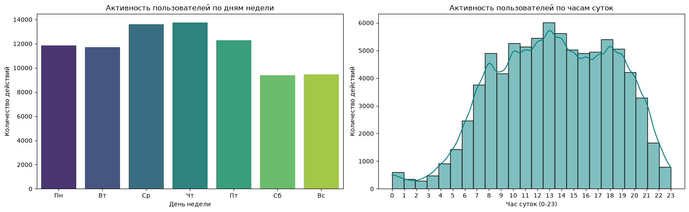

# Финальное решение кейса IT Resume
# Выполнил Алексеенко Андрей Анатольевич , программист ССМП г.Благовещенск

## Задание 1: Расчет Rolling Retention по когортам
Для расчета долгосрочного удержания пользователей был применен data-driven подход. Нулевым днем (Day 0) считалась дата регистрации.

### Сводная таблица Rolling Retention (первые строки):
* Когорта `2021-11-01` (Размер: 210): Day 0 = 90.00%, Day 7 = 57.62%, Day 30 = 47.14%, Day 90 = 26.67%
* Когорта `2022-01-01` (Размер: 602): Day 0 = 82.72%, Day 7 = 25.08%, Day 30 = 12.79%, Day 90 = 3.82%

### Продуктовые выводы для тарифов:
Наличие стабильного "хвоста" удержания пользователей (Day 60 и Day 90) на уровне нескольких процентов подтверждает ценность платформы для лояльного ядра. Для них оптимальным решением станет **годовая подписка** со скидкой. Для пользователей, которые быстро отваливаются после первой недели (Day 7), отлично подойдет короткий **недельный триал** или недорогой интенсивный доступ для экспресс-подготовки к собеседованиям.

---

## Задание 2: Расчет метрик пользовательского баланса
* **Ср. списано на 1 человека:** 27.10 CodeCoins
* **Ср. начислено на 1 человека:** 265.41 CodeCoins
* **Средний баланс:** 238.31 CodeCoins
* **Медианный баланс:** 56.00 CodeCoins

### Продуктовые выводы для ценообразования:
Огромный разрыв между средним начислением (265.41) и средним списанием (27.10) указывает на то, что пользователи накапливают бесплатную игровую валюту гораздо быстрее, чем тратят её. Медиана на уровне 56 коинов показывает реальную покупательскую способность обычного пользователя. Введение подписки позволит "сжечь" избыточную виртуальную массу коинов, предложив взамен понятный безлимитный доступ за фиксированную стоимость в рублях.

---

## Задание 3: Метрики активности и покупок контента
* **Ср. решено задач активным юзером:** 85.84
* **Ср. пройдено тестов активным юзером:** 1.68
* **Ср. попыток на 1 задачу:** 1.00
* **Ср. попыток на 1 тест:** 1.26
* **Доля активных пользователей платформы:** 63.48%

### Статистика популярности закрытого контента:
* **Открыли подсказки:** 0 чел.
* **Открыли задачи:** 53 чел.
* **Открыли тесты:** 151 чел.
* **Открыли готовые решения:** 676 чел. (Абсолютный лидер!)

### Продуктовые выводы для пейвола (Paywall):
Главным триггером для совершения платной подписки должны стать **готовые текстовые и видео-разборы решений задач** (их открывали 676 раз, что в разы больше остальных категорий) и комплексные **тесты** (151 человек). Именно эти разделы необходимо убрать под платный пейвол Premium-подписки.

## Дополнительное задание 1: Предложение 3 новых метрик для подписки

Для более глубокого анализа эффективности новой модели монетизации предлагается внедрить следующие продуктовые метрики:

1. **Частота использования платформы (L7/L30 Usage Frequency):**
   * *Что считает:* Среднее количество дней, в которые пользователь проявляет активность в течение недели или месяца.
   * *Зачем:* Позволит сегментировать аудиторию на Core-пользователей (учатся 5+ дней в неделю) и Casual-пользователей. Для Core-сегмента подписка станет очевидным и выгодным выбором.

2. **Отток после первой неуспешной попытки (First-Attempt Churn Rate):**
   * *Что считает:* Процент новичков, которые совершают одну неверную попытку решения задачи (is_false = 1) и больше никогда не возвращаются на платформу.
   * *Зачем:* Поможет обосновать ценность включения "умных подсказок" и "готовых разборов" прямо в базовые уровни подписки, чтобы удерживать пользователей от ухода на этапе столкновения с первыми трудностями.

3. **Средний чек первичного приобретения монет (First Purchase Size):**
   * *Что считает:* Сумму, которую пользователь морально готов заплатить за один раз при первом платеже на платформе.
   * *Зачем:* Послужит главным ценовым ориентиром для стоимости месячной подписки — она не должна быть значительно выше этого чека, чтобы сохранить высокую конверсию из бесплатного пользователя в платного.

---

## Дополнительное задание 2: Исследование активности для CTO

### Рекомендации для технического директора:
1. **День для релизов:** Суббота или Воскресенье. Активность пользователей падает в выходные на ~33% по сравнению со Средой и Четвергом (днями пиковой нагрузки).
2. **Время для релизов:** С 02:00 до 04:00 ночи. В эти часы нагрузка на сервер практически равна нулю, что минимизирует риски прерывания сессий пользователей во время деплоя.
