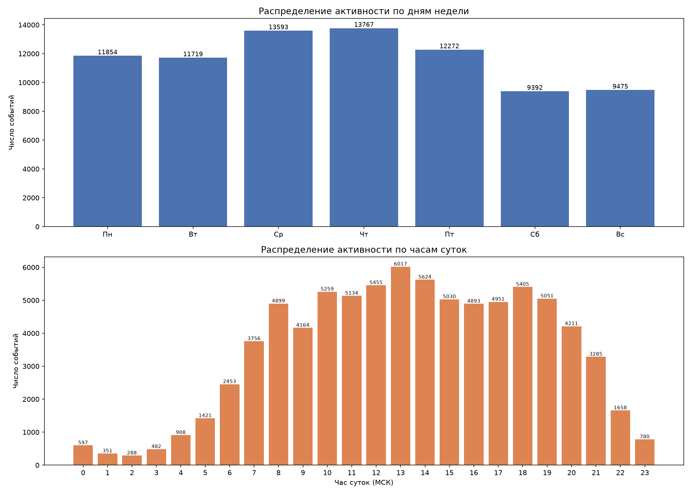

# Решение итогового проекта

Аналитика платформы IT Resume для перехода от модели CodeCoins к подписке.

#### Задание 1

Расчёт `rolling retention` по когортам (месяц регистрации). День N — считается пользователь, который проявлял активность (входил на платформу) в день N или любой день после.

```sql
with activity as (
    -- последний день активности каждого пользователя
    select user_id,
           max(entry_at::date) as last_date
    from userentry
    group by user_id
),
cohort as (
    -- когорта = месяц регистрации; days_alive — сколько дней «прожил» пользователь
    select u.id as user_id,
           date_trunc('month', u.date_joined)::date as cohort_month,
           greatest(0, a.last_date - u.date_joined::date) as days_alive
    from users u
    left join activity a on a.user_id = u.id
)
select cohort_month,
       count(*) as users,
       round(100.0 * count(days_alive) / count(*), 2) as "day_0",
       round(100.0 * count(days_alive) filter (where days_alive >= 1)  / count(*), 2) as "day_1",
       round(100.0 * count(days_alive) filter (where days_alive >= 3)  / count(*), 2) as "day_3",
       round(100.0 * count(days_alive) filter (where days_alive >= 7)  / count(*), 2) as "day_7",
       round(100.0 * count(days_alive) filter (where days_alive >= 14) / count(*), 2) as "day_14",
       round(100.0 * count(days_alive) filter (where days_alive >= 30) / count(*), 2) as "day_30",
       round(100.0 * count(days_alive) filter (where days_alive >= 60) / count(*), 2) as "day_60",
       round(100.0 * count(days_alive) filter (where days_alive >= 90) / count(*), 2) as "day_90"
from cohort
group by cohort_month
order by cohort_month
```

Результат:

| cohort_month | users | day_0 | day_1 | day_3 | day_7 | day_14 | day_30 | day_60 | day_90 |
|---|---|---|---|---|---|---|---|---|---|
| 2021-03-01 | 5 | 100.00 | 100.00 | 100.00 | 100.00 | 100.00 | 20.00 | 0.00 | 0.00 |
| 2021-04-01 | 15 | 100.00 | 60.00 | 46.67 | 33.33 | 33.33 | 0.00 | 0.00 | 0.00 |
| 2021-05-01 | 6 | 100.00 | 0.00 | 0.00 | 0.00 | 0.00 | 0.00 | 0.00 | 0.00 |
| 2021-06-01 | 6 | 100.00 | 0.00 | 0.00 | 0.00 | 0.00 | 0.00 | 0.00 | 0.00 |
| 2021-07-01 | 2 | 100.00 | 50.00 | 50.00 | 50.00 | 50.00 | 50.00 | 50.00 | 50.00 |
| 2021-08-01 | 1 | 100.00 | 100.00 | 100.00 | 100.00 | 100.00 | 100.00 | 100.00 | 100.00 |
| 2021-09-01 | 13 | 100.00 | 15.38 | 15.38 | 7.69 | 7.69 | 7.69 | 7.69 | 7.69 |
| 2021-10-01 | 8 | 100.00 | 0.00 | 0.00 | 0.00 | 0.00 | 0.00 | 0.00 | 0.00 |
| 2021-11-01 | 210 | 100.00 | 65.24 | 59.52 | 57.62 | 54.76 | 47.14 | 36.67 | 26.67 |
| 2021-12-01 | 132 | 100.00 | 50.00 | 40.15 | 38.64 | 33.33 | 28.79 | 21.21 | 12.12 |
| 2022-01-01 | 602 | 100.00 | 36.88 | 30.56 | 25.08 | 20.93 | 12.79 | 7.64 | 3.82 |
| 2022-02-01 | 1058 | 100.00 | 27.60 | 20.04 | 13.89 | 10.87 | 8.03 | 4.82 | 1.04 |
| 2022-03-01 | 479 | 100.00 | 30.06 | 22.76 | 16.08 | 12.53 | 7.31 | 1.04 | 0.00 |
| 2022-04-01 | 237 | 100.00 | 41.77 | 32.07 | 25.74 | 19.41 | 9.28 | 0.00 | 0.00 |

Выводы:

- **До ноября 2021 когорты крошечные** (2–15 человек) — на их цифры нельзя опираться, это явно бета-период платформы. Смотрим на массовые когорты: ноябрь 2021 (210), декабрь 2021 (132), январь 2022 (602), февраль 2022 (1058), март 2022 (479), апрель 2022 (237).
- **Retention падает очень быстро**: уже через 7 дней после регистрации активны лишь 14–58% (в свежих когортах — 14–26%), а к 30 дню остаётся 8–12% у массовых когорт 2022 года. Основной «обрыв» происходит в первые 7 дней жизни пользователя.
- **К 90 дням остаётся 0–4%** пользователей даже у больших когорт. Платформа используется скорее как «разовый инструмент подготовки к собеседованию», чем как сервис постоянных тренировок.
- **Для подписки это значит**: закладывать в базовый тариф длинный период (год) рискованно — большинство пользователей «отваливается» в первые 30 дней. Логичен короткий тариф на 1–4 недели (пользователь успевает решить свои задачи за это время) и длинный — со скидкой, но как «ловушка лояльности» для тех 3–12%, кто действительно занимается месяцами. При этом 30-дневный тариф выглядит оптимальным компромиссом: значительная часть отсева происходит именно после 14–30 дней, и подписка должна «прожить» хотя бы этот срок.

#### Задание 2

Метрики баланса пользователей — всё в одном запросе. Списания — типы 1, 23–28, 30; начисления — все остальные.

```sql
with typed as (
    select t.user_id,
           case when t.type_id in (1, 23, 24, 25, 26, 27, 28, 30)  -- типы-списания
                then -t.value else t.value
           end as amount
    from transaction t
),
balances as (
    -- считаем баланс и обороты по каждому пользователю, у которого есть транзакции
    select user_id,
           sum(amount) as balance,
           sum(-amount) filter (where amount < 0) as write_off,
           sum(amount)  filter (where amount > 0) as top_up
    from typed
    group by user_id
)
select round(avg(write_off)::numeric, 2)   as avg_write_off_per_user,
       round(avg(top_up)::numeric, 2)      as avg_top_up_per_user,
       round(avg(balance)::numeric, 2)     as avg_balance,
       round(percentile_cont(0.5) within group (order by balance)::numeric, 2) as median_balance
from balances
```

Результат:

| avg_write_off_per_user | avg_top_up_per_user | avg_balance | median_balance |
|---|---|---|---|
| 75.78 | 306.52 | 275.22 | 62.00 |

Выводы:

- **Средний и медианный баланс сильно расходятся** (275 против 62): распределение баланса крайне скошенное — есть «киты» с балансом более 25 000 монет (вероятно, купили большой пакет), которые тянут среднее вверх. Медиана 62 монеты гораздо лучше отражает «типичного» пользователя.
- **Начислений в 4 раза больше, чем списаний** (306.5 против 75.8 монет на человека): экономика «подкручена» в пользу игрока — монет у среднего пользователя избыток, покупать их за деньги почти незачем. Это подтверждает главный недостаток текущей модели: валюта обесценена щедрыми начислениями за активность.
- **Для подписки**: раз «типичный» пользователь за всю жизнь тратит ~76 монет (медиана списаний — всего 30), стоимость подписки в монетном эквиваленте должна быть небольшой. Но правильнее привязать цену подписки к деньгам за контент, который она открывает: суммарный объём списаний за открытые материалы (задачи, решения, подсказки) — это и есть «естественная» willingness to pay. Средние показатели стоит считать именно по пользователям с транзакциями (как в запросе), а не по всем зарегистрированным — иначе среднее размывается теми, кто ни разу ничего не получал и не тратил.

#### Задание 3

Метрики активности (только для пользователей, которые решали задачи или проходили тесты) — одним запросом:

```sql
with problem_stats as (
    -- статистика по решению задач: сколько задач решил пользователь, сколько попыток на задачу
    select user_id,
           count(distinct problem_id) as n_problems,
           count(*)::numeric / count(distinct problem_id) as attempts_per_problem
    from codesubmit
    group by user_id
),
test_stats as (
    -- статистика по тестам: сколько тестов проходил, сколько попыток на тест
    select user_id,
           count(distinct test_id) as n_tests,
           count(*)::numeric / count(distinct test_id) as attempts_per_test
    from teststart
    group by user_id
)
select round(avg(p.n_problems)::numeric, 2)           as avg_problems_per_user,
       round(avg(t.n_tests)::numeric, 2)              as avg_tests_per_user,
       round(avg(p.attempts_per_problem)::numeric, 2) as avg_attempts_per_problem,
       round(avg(t.attempts_per_test)::numeric, 2)    as avg_attempts_per_test
from problem_stats p
join test_stats t on t.user_id = p.user_id
```

Результат: `avg_problems_per_user = 9.52`, `avg_tests_per_user = 1.02`, `avg_attempts_per_problem = 3.17`, `avg_attempts_per_test = 1.27`.

Плюс доля «активных» пользователей платформы:

```sql
with solvers as (
    select distinct user_id from codesubmit
),
testers as (
    select distinct user_id from teststart
)
select round(100.0 * count(distinct coalesce(s.user_id, t.user_id))
             / (select count(*) from users), 2) as active_share_pct
from solvers s
full outer join testers t on s.user_id = t.user_id
```

Результат: `61.97%` пользователей хотя бы раз решали задачу или начинали тест.

Покупки за кодкоины (все 7 чисел одним запросом):

```sql
with purchases as (
    select t.user_id, t.type_id
    from transaction t
    where t.type_id in (23, 24, 25, 26, 27, 28)  -- покупки контента за кодкоины
)
select count(distinct user_id) filter (where type_id = 23)          as users_open_problems,
       count(distinct user_id) filter (where type_id = 27)          as users_open_tests,
       count(distinct user_id) filter (where type_id = 24)          as users_open_hints,
       count(distinct user_id) filter (where type_id = 25)          as users_open_solutions,
       count(*)                                                     as total_purchases,
       count(distinct user_id)                                      as users_with_any_purchase,
       (select count(distinct user_id) from transaction)            as users_with_any_tx
from purchases
```

Результат:

| users_open_problems | users_open_tests | users_open_hints | users_open_solutions | total_purchases | users_with_any_purchase | users_with_any_tx |
|---|---|---|---|---|---|---|
| 522 | 676 | 53 | 151 | 3205 | 1139 | 2402 |

Выводы:

- **Активность концентрируется в тестах**: 44.1% всех пользователей проходили тесты против 31.0% решавших задачи. При этом задач в среднем решается много (9.5 на активного пользователя), а тестов ~1. Тесты — более «массовый», задачи — более «глубокий» формат.
- **Попыток на задачу — 3.17, на тест — 1.27**: пользователь в среднем трижды проверяет решение задачи, прежде чем сдастся/решит. Значит, лимит попыток даже в бесплатной версии не должен быть жёстким (например, 3–5) — иначе сломаем базовый функционал, о чём прямо сказано в условиях.
- **Покупают контент меньше половины «экономически живых» пользователей**: что-то покупали 1139 человек из 2402 с транзакциями (47%), а доля от всех зарегистрированных — всего 41%. Основные покупки — открытие тестов (676 чел.) и задач (522 чел.); подсказки (53 чел.) и решения (151 чел.) востребованы заметно меньше — они нишевые, но именно «горячие» (человек застрял и готов платить здесь и сейчас).
- **Для подписки**: в бесплатный тариф логично оставить большую часть задач и тестов, а платным сделать доступ к решениям и «закрытым» задачам от компаний. При этом нишевые горячие продукты (решения, подсказки) — хороший аргумент именно за подписку: разовая покупка монет для них неудобна (нужно покупать целый пакет ради одного решения).

#### Дополнительное задание

Мне кажется, что для перехода на подписку не хватает метрик, которые описывают **платёжное поведение** и **глубину вовлечённости** в первые дни жизни пользователя — именно они определяют, каким должен быть короткий тариф и что включать в платную часть. Для этого я предлагаю посчитать три метрики, потому что:

- они показывают, **когда пользователь «созревает» до первой оплаты** — от этого зависит длина краткосрочного тарифа;
- они показывают, **сколько раз платящий пользователь возвращается к покупкам** — то есть это оценка LTV-потенциала подписки против разовых покупок;
- они показывают, **сколько активных дней пользователь даёт платформе в первый месяц** — это опорная точка для определения длительности основного тарифа.

**Метрика 1. Время от регистрации до первой покупки контента.**
Показывает, как быстро пользователь понимает ценность платного контента. Если люди платят в день регистрации — их можно конвертировать в подписку сразу, коротким тарифом.

```sql
with purchases as (
    -- первая покупка контента за кодкоины для каждого пользователя
    select user_id,
           min(created_at::date) as first_purchase
    from transaction
    where type_id in (23, 24, 25, 26, 27, 28)
    group by user_id
)
select count(*) as buyers,
       round(avg(first_purchase - u.date_joined::date)::numeric, 1)   as avg_days_to_first_purchase,
       round(percentile_cont(0.5) within group (order by first_purchase - u.date_joined::date)::numeric, 1) as median_days
from purchases p
join users u on u.id = p.user_id
```

**Метрика 2. Число покупок на одного платящего пользователя.**
Показывает, возвращается ли человек к покупкам повторно. Если медиана = 1, а среднее 2.8 — платят немногие, но «киты» тянут среднее вверх. Для подписки важна именно повторяемость.

```sql
select round(avg(cnt)::numeric, 2) as avg_purchases_per_buyer,
       round(percentile_cont(0.5) within group (order by cnt)::numeric, 2) as median_purchases,
       max(cnt) as max_purchases
from (
    select user_id, count(*) as cnt
    from transaction
    where type_id in (23, 24, 25, 26, 27, 28)
    group by user_id
) t
```

**Метрика 3. Число активных дней пользователя за первые 30 дней жизни.**
Показывает реальную глубину вовлечённости в первый месяц. Если активных дней мало — месячный тариф с избытком покрывает жизнь пользователя, и можно смело делать его основным.

```sql
with acts as (
    -- смещение каждого дня входа относительно дня регистрации
    select e.user_id,
           (e.entry_at::date - u.date_joined::date) as day_offset
    from userentry e
    join users u on u.id = e.user_id
)
select round(avg(days_in_first_month)::numeric, 2) as avg_active_days_first_month,
       round(percentile_cont(0.5) within group (order by days_in_first_month)::numeric, 2) as median_active_days
from (
    select user_id, count(*) as days_in_first_month
    from acts
    where day_offset between 0 and 30
    group by user_id
) t
```

Выводы:

- **Метрика 1**: из 1139 покупателей медианное время до первой покупки — **0 дней** (среднее 3.7 из-за «отложенных» пользователей). Люди платят практически сразу после регистрации — значит, экран продажи подписки должен быть показан максимально рано, и короткий тариф должен быть доступен в первый же день.
- **Метрика 2**: в среднем 2.81 покупки на платящего, но **медиана — всего 1** (максимум 123). Подавляющее большинство платит один раз и уходит. Это сильный аргумент за подписку: она «фиксирует» платёж на период вперед, вместо того чтобы надеяться на повторные мелкие покупки.
- **Метрика 3**: за первые 30 дней жизни у пользователя в среднем **2.2 активных дня** (медиана 1). Основной тариф на месяц — с запасом, а для большинства будет достаточно даже недельного. Это подтверждает линейку тарифов «неделя / месяц / год».

#### Итоговые выводы по смене модели монетизации

Я считаю, что вам нужно сделать ставку на **комбинированную модель**: оставить бесплатный базовый функционал (большинство задач и тестов открыты, ~3–5 попыток на задачу) и ввести подписку из двух-трёх тарифов, потому что:

- Данные показывают, что **жизненный цикл пользователя короткий**: к 30 дню остаётся лишь 8–12% когорты, к 90 — 0–4%. Годовая подписка «в лоб» почти никому не нужна; основной тариф — месячный, а годовой — только со скидкой (для оставшихся 3–12% лояльных).
- **Валюта обесценена**: начислений (306 монет) в 4 раза больше, чем списаний (76 монет), при медианном балансе 62 и медианных списаниях 30 монет. Дозаполнять баланс деньгами пользователю почти незачем — покупка монет не решает проблему монетизации. Подписка за фиксированные деньги снимает эту проблему.
- **Платный контент понятен из данных**: чаще всего покупают доступ к тестам (676 чел.) и закрытым задачам (522 чел.), а «горячие» нишевые продукты — решения (151 чел.) и подсказки (53 чел.). В подписку стоит включить: неограниченный доступ к закрытым задачам и решениям, подсказки, топовые задачи от компаний и дополнительные разделы (кейсы/вопросы).
- А еще, беря во внимание, что 47% пользователей с транзакциями уже покупали контент, — есть сформированная привычка платить, и подписка с адекватной ценой (ориентир — сколько пользователь готов потратить за 1 «спринт» подготовки, то есть на 2–4 недели активного использования) конвертирует её лучше, чем продажа пакетов монет.

Рекомендуемая линейка: **короткая** подписка на 1–2 недели (для «здесь и сейчас» — готовлюсь к собеседованию на этой неделе), **месячная** (основной тариф) и **годовая** с заметной скидкой (для лояльного меньшинства, которое и так занимается месяцами).

#### Дополнительное задание 2

Для выгрузки данных используем SQL-запрос (активности = запуски кода + проверки решений + старты тестов):

```sql
with activity as (
    select user_id, created_at from coderun
    union all
    select user_id, created_at from codesubmit
    union all
    select user_id, created_at from teststart
)
select extract(isodow from created_at)::int as dow,  -- 1 = Пн ... 7 = Вс
       extract(hour from created_at)::int  as hour,
       count(*)                            as events
from activity
group by dow, hour
order by dow, hour
```

Результат выгружаем в `activity.csv` (день недели, час, число событий).

Для загрузки данных, построения графика, анализа по дням недели и часам используем такой код:

```python
import pandas as pd
import matplotlib
matplotlib.use('Agg')
import matplotlib.pyplot as plt

# читаем выгрузку: день недели (1=Пн..7=Вс), час, число событий
df = pd.read_csv('activity.csv')

# русские названия дней для подписей
days = {1: 'Пн', 2: 'Вт', 3: 'Ср', 4: 'Чт', 5: 'Пт', 6: 'Сб', 7: 'Вс'}
df['day'] = df['dow'].map(days)
order = ['Пн', 'Вт', 'Ср', 'Чт', 'Пт', 'Сб', 'Вс']

fig, axes = plt.subplots(2, 1, figsize=(14, 10))

# график 1: суммарная активность по дням недели
daily = df.groupby('day')['events'].sum().reindex(order)
axes[0].bar(daily.index, daily.values, color='#4c72b0')
axes[0].set_title('Распределение активности по дням недели', fontsize=13)
axes[0].set_ylabel('Число событий')
for i, v in enumerate(daily.values):  # подписываем столбцы значениями
    axes[0].text(i, v, str(v), ha='center', va='bottom', fontsize=9)

# график 2: суммарная активность по часам суток
hourly = df.groupby('hour')['events'].sum()
axes[1].bar(hourly.index, hourly.values, color='#dd8452')
axes[1].set_title('Распределение активности по часам суток', fontsize=13)
axes[1].set_xlabel('Час суток (МСК)')
axes[1].set_ylabel('Число событий')
axes[1].set_xticks(range(24))
for i, v in enumerate(hourly.values):
    axes[1].text(i, v, str(v), ha='center', va='bottom', fontsize=7)

plt.tight_layout()
plt.savefig('activity_by_time.png', dpi=150)
```

График: 

Выводы: Рекомендую проводить релизы в **вторник или среду в первой половине дня**, оптимально — в интервале **14:00–17:00 МСК**, потому что:

- **Самые тихие дни — выходные** (Сб 9 392, Вс 9 475 событий против 13 600–13 800 в Чт/Ср). Но релиз в выходной делать не стоит: если что-то сломается — починить будет некому, а пользователи увидят проблему в понедельник утром.
- **В будни активность падает ночью**: минимум — 01:00–03:00 МСК (288–351 событие в час за всю историю), максимум — 11:00–14:00 МСК (пик: четверг 12:00 — 1 214 событий). Вечером активность плавно снижается после ~19:00.
- **Оптимальное окно для релиза — вторник или среда 14:00–17:00 МСК**: в это время уже спадает дневной пик (11:00–14:00), поэтому мелкие проблемы не заденут максимум пользователей, а до вечернего и следующего утреннего пика останется время всё проверить и откатить. Четверг и пятницу (самые нагруженные дни) лучше не трогать — там любой сбой заденет больше всего людей.
