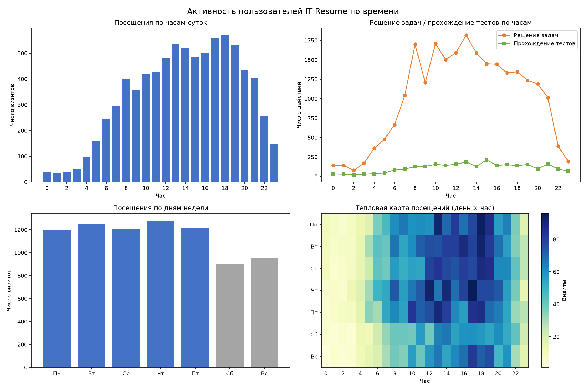

Автор {{Дужнова В.Е.}}
Задание 1. 

WITH base AS (
    SELECT u.id AS user_id,
           DATE_TRUNC('month', u.date_joined)::date AS cohort_month,
           -- день последней активности относительно дня регистрации;
           -- если активностей нет, считаем, что человек отвалился сразу
           COALESCE(MAX(e.entry_at::date - u.date_joined::date), -1) AS last_active_day
    FROM users u
    LEFT JOIN userentry e ON e.user_id = u.id
    GROUP BY u.id, DATE_TRUNC('month', u.date_joined)::date
)
SELECT cohort_month,
       COUNT(*) AS users,
       ROUND(100.0 * COUNT(*) FILTER (WHERE last_active_day >= 0)  / COUNT(*), 2) AS day_0,
       ROUND(100.0 * COUNT(*) FILTER (WHERE last_active_day >= 1)  / COUNT(*), 2) AS day_1,
       ROUND(100.0 * COUNT(*) FILTER (WHERE last_active_day >= 3)  / COUNT(*), 2) AS day_3,
       ROUND(100.0 * COUNT(*) FILTER (WHERE last_active_day >= 7)  / COUNT(*), 2) AS day_7,
       ROUND(100.0 * COUNT(*) FILTER (WHERE last_active_day >= 14) / COUNT(*), 2) AS day_14,
       ROUND(100.0 * COUNT(*) FILTER (WHERE last_active_day >= 30) / COUNT(*), 2) AS day_30,
       ROUND(100.0 * COUNT(*) FILTER (WHERE last_active_day >= 60) / COUNT(*), 2) AS day_60,
       ROUND(100.0 * COUNT(*) FILTER (WHERE last_active_day >= 90) / COUNT(*), 2) AS day_90
FROM base
GROUP BY cohort_month
ORDER BY cohort_month;

 Результат

| Когорта | Польз. | d0 | d1 | d3 | d7 | d14 | d30 | d60 | d90 |
|---|---|---|---|---|---|---|---|---|---|
| 2021-03 | 5 | 100.00 | 100.00 | 100.00 | 100.00 | 100.00 | 20.00 | 0.00 | 0.00 |
| 2021-04 | 15 | 60.00 | 60.00 | 46.67 | 33.33 | 33.33 | 0.00 | 0.00 | 0.00 |
| 2021-05 | 6 | 0.00 | 0.00 | 0.00 | 0.00 | 0.00 | 0.00 | 0.00 | 0.00 |
| 2021-06 | 6 | 0.00 | 0.00 | 0.00 | 0.00 | 0.00 | 0.00 | 0.00 | 0.00 |
| 2021-07 | 2 | 50.00 | 50.00 | 50.00 | 50.00 | 50.00 | 50.00 | 50.00 | 50.00 |
| 2021-08 | 1 | 100.00 | 100.00 | 100.00 | 100.00 | 100.00 | 100.00 | 100.00 | 100.00 |
| 2021-09 | 13 | 15.38 | 15.38 | 15.38 | 7.69 | 7.69 | 7.69 | 7.69 | 7.69 |
| 2021-10 | 8 | 0.00 | 0.00 | 0.00 | 0.00 | 0.00 | 0.00 | 0.00 | 0.00 |
| 2021-11 | 210 | 90.00 | 65.24 | 59.52 | 57.62 | 54.76 | 47.14 | 36.67 | 26.67 |
| 2021-12 | 132 | 91.67 | 50.00 | 40.15 | 38.64 | 33.33 | 28.79 | 21.21 | 12.12 |
| 2022-01 | 602 | 82.72 | 36.88 | 30.56 | 25.08 | 20.93 | 12.79 | 7.64 | 3.82 |
| 2022-02 | 1058 | 84.22 | 27.60 | 20.04 | 13.89 | 10.87 | 8.03 | 4.82 | 1.04 |
| 2022-03 | 479 | 86.64 | 30.06 | 22.76 | 16.08 | 12.53 | 7.31 | 1.04 | 0.00 |
| 2022-04 | 237 | 87.76 | 41.77 | 32.07 | 25.74 | 19.41 | 9.28 | 0.00 | 0.00 |

 Выводы

Маленькие когорты (до октября 2021 — по 2–15 человек) не подходят для выводов: слишком мало людей. Более 95% пользователей приходятся на когорты с ноября 2021 по апрель 2022.
Самое важное происходит в первые сутки: в день регистрации на платформу заходят почти все (84–90%), но уже на следующий день их остаётся 28–65%. Если человек не вернулся на второй день, дальше он, скорее всего, не вернётся уже никогда.
Дальше люди «отваливаются» гораздо медленнее. К концу первой недели (дни 7–14) картина почти не меняется — те, кто остался, уже превращаются в постоянных пользователей.
Месяц доживают только 7–12%, три месяца — почти никто (0–4%).
Что это значит для подписки: люди делятся на две группы — «зашёл на недельку порешать» и «занимается постоянно». Под это и делаем тарифы: короткий (неделя — для первой группы) и месяц/год со скидкой (для постоянных пользователей). Годовой без большой скидки продавать бессмысленно — людей, которые пользуются платформой так долго, слишком мало.
Отдельно интересна когорта ноября 2021 — у неё лучший результат (26.67% остаются через 90 дней). Это первые пользователи после запуска; что-то в этот период работало особенно хорошо — стоит разобраться, что именно, и повторить.

Задание 2.


WITH bal AS (
    SELECT user_id,
           SUM(CASE WHEN type_id IN (1, 23, 24, 25, 26, 27, 28) THEN value ELSE 0 END) AS spent,
           SUM(CASE WHEN type_id NOT IN (1, 23, 24, 25, 26, 27, 28) THEN value ELSE 0 END) AS earned
    FROM "transaction"
    GROUP BY user_id
)
SELECT ROUND(AVG(spent)::numeric, 2)                 AS avg_spent,
       ROUND(AVG(earned)::numeric, 2)                AS avg_earned,
       ROUND(AVG(earned - spent)::numeric, 2)        AS avg_balance,
       ROUND((PERCENTILE_CONT(0.5) WITHIN GROUP (ORDER BY earned - spent))::numeric, 2) AS median_balance
FROM bal;
 
Примечание: медиана посчитана через `PERCENTILE_CONT(0.5) WITHIN GROUP` — корректное определение медианы в PostgreSQL. Упомянутая в задании конструкция `mode within group` возвращает моду (самое частое значение), а не медиану.

 Результат

| Метрика | Значение (коины) |
|---|---|
| Средние списания на 1 человека | 31.29 |
| Средние начисления на 1 человека | 306.52 |
| Средний баланс | 275.22 |
| Медианный баланс | 62.00 |

Вариант усреднения по всем 2 774 пользователям: списания 27.10, начисления 265.41, средний баланс 238.31, медиана 56.00.

 Выводы

Среднее на счету (275 коинов) в 4.5 раза больше, чем у половины пользователей (медиана — 62). Это значит, что несколько «китов» с огромными балансами завышают среднюю картинку, а у обычного пользователя на счету совсем немного — всего 62 коина.
Люди тратят мало: в среднем за всё время списывается 31 коин на человека, хотя начислено 306. То есть коины копятся, а не тратятся. При этом за деньги коины почти никто не покупал: за всё время было всего 37 пополнений на 2 402 пользователей (то есть примерно 1 из 65). Получается, платформа практически ничего не зарабатывает на текущей модели — значит, переход на подписку действительно нужен.
Цену подписки логично привязывать к обычному пользователю (медиане), а не к среднему: типичный пользователь тратит десятки коинов. Если примерно прикинуть, что 1 коин стоит 2–4 рубля, месячная подписка в районе 150–300 рублей закроет его потребности. Точный курс коина к рублю нужно уточнить у IT Resume — тогда цену можно зафиксировать точнее.
У многих пользователей просто лежат «мёртвые» коины (в среднем 275 на человека). Хорошая идея — позволить обменять эти накопления на скидку или первые месяцы подписки. Так пользователи не потеряют накопленное и охотнее перейдут на новый формат.

Задание 3. Активность и покупки за CodeCoins


WITH users_total AS (
    SELECT COUNT(*) AS total_users FROM users
),
task_stats AS (
    SELECT COUNT(DISTINCT user_id) AS users_submitted,
           COUNT(DISTINCT user_id || '-' || problem_id) AS user_problem_pairs,
           COUNT(*) AS attempts
    FROM codesubmit
),
solved_stats AS (
    SELECT user_id, COUNT(DISTINCT problem_id) AS solved_cnt
    FROM codesubmit WHERE is_false = 0
    GROUP BY user_id
),
test_start AS (
    SELECT COUNT(DISTINCT user_id) AS users_started,
           COUNT(DISTINCT user_id || '-' || test_id) AS user_test_pairs,
           COUNT(*) AS attempts
    FROM teststart
),
test_pass AS (
    SELECT user_id, COUNT(DISTINCT test_id) AS passed_cnt
    FROM testresult
    GROUP BY user_id
),
purchases AS (
    SELECT 'task' AS what, COUNT(DISTINCT user_id) AS users, COUNT(*) AS opens
    FROM "transaction" WHERE type_id = 23
    UNION ALL
    SELECT 'test', COUNT(DISTINCT user_id), COUNT(*)
    FROM "transaction" WHERE type_id = 27
    UNION ALL
    SELECT 'hint', COUNT(DISTINCT user_id), COUNT(*)
    FROM "transaction" WHERE type_id = 24
    UNION ALL
    SELECT 'solution', COUNT(DISTINCT user_id), COUNT(*)
    FROM "transaction" WHERE type_id = 25
)
SELECT
    (SELECT ROUND(AVG(solved_cnt)::numeric, 2) FROM solved_stats)               AS avg_solved_tasks,
    (SELECT ROUND(AVG(passed_cnt)::numeric, 2) FROM test_pass)                  AS avg_passed_tests,
    (SELECT ROUND(attempts::numeric / user_problem_pairs, 2) FROM task_stats)   AS avg_attempts_per_task,
    (SELECT ROUND(attempts::numeric / user_test_pairs, 2) FROM test_start)      AS avg_attempts_per_test,
    ROUND(100.0 * (SELECT COUNT(DISTINCT user_id)
                   FROM (SELECT user_id FROM codesubmit
                         UNION
                         SELECT user_id FROM teststart) a)
                 / (SELECT total_users FROM users_total), 2)                    AS pct_active_users,
    (SELECT users FROM purchases WHERE what = 'task')                           AS users_bought_tasks,
    (SELECT users FROM purchases WHERE what = 'test')                           AS users_bought_tests,
    (SELECT users FROM purchases WHERE what = 'hint')                           AS users_bought_hints,
    (SELECT users FROM purchases WHERE what = 'solution')                       AS users_bought_solutions,
    (SELECT SUM(opens) FROM purchases)                                          AS total_opens,
    (SELECT COUNT(DISTINCT user_id) FROM "transaction"
     WHERE type_id IN (23, 24, 25, 26, 27, 28))                                 AS users_any_purchase,
    (SELECT COUNT(DISTINCT user_id) FROM "transaction")                         AS users_any_transaction,
    (SELECT total_users FROM users_total)                                       AS total_users;

 Результат

| Метрика | Значение |
|---|---|
| Среднее число решённых задач (на решающего) | 10.53 |
| Среднее число пройденных тестов (на проходящего) | 1.62 |
| Среднее число попыток на 1 задачу | 2.90 |
| Среднее число попыток на 1 тест | 1.26 |
| Доля пользователей, решавших задачу или начинавших тест | 61.97% |
| Покупали задачи за коины | 522 чел. |
| Покупали тесты за коины | 676 чел. |
| Покупали подсказки за коины | 53 чел. |
| Покупали решения за коины | 151 чел. |
| Всего фактов открытия контента за коины | 3 205 |
| Покупали хотя бы что-то из этого | 1 139 чел. |
| Пользователей с хотя бы 1 транзакцией | 2 402 чел. |
| Всего пользователей | 2 774 чел. |

 Выводы

Активность хорошая: почти 2 из 3 пользователей (62%) решают задачи или проходят тесты. Значит, можно смело оставлять большую часть контента бесплатной — люди и так занимаются.
На одну задачу пользователь тратит примерно 3 попытки — то есть задачи даются непросто, и помощь (подсказки, решения) была бы очень кстати. Но подсказки и решения почти не покупают за коины — их взяли всего 53 и 151 человек соответственно. Видимо, отдельно покупать их не хочется,но в подписке они могут идти бесплатно.
Что покупают охотнее всего: тесты (676 человек), на втором месте — задачи (522). Тесты короткие и дешёвые, как раз для тех, кто хочет позаниматься срочно и ненадолго. Под это подходит недельный тариф.
Покупать за коины хотя бы что-то пробовали 1 139 человек — это 41% всех пользователей. Это готовая аудитория для подписки: им просто нужно предложить удобство — «плати раз в месяц и решай всё без ограничений», — вместо того чтобы каждый раз откладывать коины.
Есть и риск: почти половина пользователей (45%) заходила на платформу, но ничего не покупала. Чтобы не потерять их, в бесплатной версии должны остаться базовые задачи и хотя бы часть тестов.

 Дополнительные метрики (самостоятельное исследование)

Метрика 1. Время от регистрации до первой покупки за коины

Отвечает на вопрос «когда предлагать подписку» — сразу в онбординге или после прогрева.


WITH first_buy AS (
    SELECT t.user_id, MIN(t.created_at) AS first_buy_at
    FROM "transaction" t
    WHERE t.type_id IN (23, 24, 25, 26, 27, 28)
    GROUP BY t.user_id
)
SELECT
    COUNT(*) AS buyers,
    ROUND((PERCENTILE_CONT(0.5)  WITHIN GROUP (ORDER BY (fb.first_buy_at::date - u.date_joined::date)))::numeric, 1) AS median_days,
    ROUND((PERCENTILE_CONT(0.25) WITHIN GROUP (ORDER BY (fb.first_buy_at::date - u.date_joined::date)))::numeric, 1) AS p25_days,
    ROUND((PERCENTILE_CONT(0.75) WITHIN GROUP (ORDER BY (fb.first_buy_at::date - u.date_joined::date)))::numeric, 1) AS p75_days,
    ROUND(AVG((fb.first_buy_at::date - u.date_joined::date))::numeric, 1) AS avg_days,
    ROUND(100.0 * COUNT(*) FILTER (WHERE fb.first_buy_at::date - u.date_joined::date <= 0)  / COUNT(*), 1) AS pct_day0,
    ROUND(100.0 * COUNT(*) FILTER (WHERE fb.first_buy_at::date - u.date_joined::date <= 7)  / COUNT(*), 1) AS pct_le7,
    ROUND(100.0 * COUNT(*) FILTER (WHERE fb.first_buy_at::date - u.date_joined::date <= 14) / COUNT(*), 1) AS pct_le14,
    ROUND(100.0 * COUNT(*) FILTER (WHERE fb.first_buy_at::date - u.date_joined::date <= 30) / COUNT(*), 1) AS pct_le30
FROM first_buy fb
JOIN users u ON u.id = fb.user_id;

Результат: покупателей 1 139; медиана времени до первой покупки — 0 дней (P25 = P75 = 0), среднее — 3.7 дня; 83.4% покупают в день регистрации, 92.4% — в первые 7 дней, 96.0% — в первые 30.

Вывод: платёжное решение принимается в первой сессии → подписку показывать уже в онбординге и на экране первой покупки; недельный тариф/триал попадает в момент максимальной готовности платить. При этом первая «покупка» сейчас часто тратит приветственный бонус, а не деньги — подписку нужно продавать с явной ценностью.

 Метрика 2. Помесячная динамика реальных пополнений и расхода коинов

Зачем: прямая оценка монетизации текущей модели и тренда спроса на платный контент.

SELECT DATE_TRUNC('month', created_at)::date AS month,
       COUNT(*) FILTER (WHERE type_id = 2) AS topup_cnt,
       COALESCE(SUM(value) FILTER (WHERE type_id = 2), 0) AS topup_coins,
       COALESCE(SUM(value) FILTER (WHERE type_id IN (1,23,24,25,26,27,28)), 0) AS spent_coins
FROM "transaction"
GROUP BY 1
ORDER BY 1;


Результат: за весь период всего 37 пополнений за деньги (средний размер 933.8 коина, медианный 100); при этом расход коинов вырос с 7 810 (ноябрь 2021) до 23 105 (февраль 2022) и составляет десятки тысяч в месяц.

Вывод: монетизация через покупку коинов практически не работает — подписка не каннибализирует существующую выручку (терять нечего), а растущий расход коинов — готовый спрос, который подписка впервые превратит в деньги.

Метрика 3. Повторность покупок

Зачем: формируется ли привычка платить; подписка превращает разовые траты в регулярный доход.


WITH buys AS (
    SELECT user_id, COUNT(*) AS buys
    FROM "transaction"
    WHERE type_id IN (23, 24, 25, 26, 27, 28)
    GROUP BY user_id
)
SELECT COUNT(*) AS buyers,
       ROUND(AVG(buys)::numeric, 2) AS avg_buys,
       ROUND((PERCENTILE_CONT(0.5) WITHIN GROUP (ORDER BY buys))::numeric, 1) AS median_buys,
       ROUND(100.0 * COUNT(*) FILTER (WHERE buys >= 2) / COUNT(*), 1) AS pct_repeat_buyers,
       ROUND(100.0 * COUNT(*) FILTER (WHERE buys >= 5) / COUNT(*), 1) AS pct_ge5_buys
FROM buys;


Результат: медианный покупатель делает 1 покупку, среднее — 2.81; 35.6% покупателей имеют 2+ покупки, 10.8% — 5+.

Вывод: привычка платить не формируется — подписка решает именно это. Годовой тариф «продавать» ядру с 5+ покупками (10.8%), остальным — месячный без длинных обязательств.

Метрика 4. Длительность активной жизни пользователя

Зачем: определить целевой срок подписки — от «однодневных» пользователей до ядра, занимающегося месяцами.

WITH life AS (
    SELECT u.id AS user_id,
           MIN(e.entry_at)::date AS first_day,
           MAX(e.entry_at)::date AS last_day
    FROM users u
    JOIN userentry e ON e.user_id = u.id
    GROUP BY u.id
)
SELECT COUNT(*) AS users,
       ROUND((PERCENTILE_CONT(0.5) WITHIN GROUP (ORDER BY (last_day - first_day)))::numeric, 1) AS median_life_days,
       ROUND(AVG(last_day - first_day)::numeric, 1) AS avg_life_days,
       ROUND(100.0 * COUNT(*) FILTER (WHERE last_day - first_day = 0) / COUNT(*), 1) AS pct_life_0,
       ROUND(100.0 * COUNT(*) FILTER (WHERE last_day - first_day BETWEEN 1 AND 7) / COUNT(*), 1) AS pct_life_1_7,
       ROUND(100.0 * COUNT(*) FILTER (WHERE last_day - first_day BETWEEN 8 AND 30) / COUNT(*), 1) AS pct_life_8_30,
       ROUND(100.0 * COUNT(*) FILTER (WHERE last_day - first_day > 30) / COUNT(*), 1) AS pct_life_gt30
FROM life;


Результат: среди 2 343 пользователей с активностью медиана жизни — 0 дней, среднее — 14.0; 59.5% «живут» один день, 15.5% — 1–7 дней, 10.3% — 8–30 дней, 14.7% — больше 30 дней.

Вывод: 59.5% однодневных пользователей → дешёвый недельный тариф и сильный онбординг; ~25% живут дольше недели, 14.7% (~345 человек) — больше месяца → месячная подписка для них естественна, годовая реалистична для ядра 30+ дней.

Метрика 5. Реферальная механика

Зачем: проверить, работает ли реферальный канал как источник лояльных пользователей.


WITH base AS (
    SELECT u.id AS user_id,
           (u.referal_user IS NOT NULL) AS is_referred,
           COALESCE(MAX(e.entry_at::date - u.date_joined::date), -1) AS last_day
    FROM users u
    LEFT JOIN userentry e ON e.user_id = u.id
    GROUP BY u.id, u.referal_user
)
SELECT is_referred,
       COUNT(*) AS users,
       ROUND(100.0 * COUNT(*) FILTER (WHERE last_day >= 1) / COUNT(*), 2) AS d1,
       ROUND(100.0 * COUNT(*) FILTER (WHERE last_day >= 7) / COUNT(*), 2) AS d7,
       ROUND(100.0 * COUNT(*) FILTER (WHERE last_day >= 30) / COUNT(*), 2) AS d30,
       ROUND(100.0 * COUNT(*) FILTER (WHERE last_day >= 60) / COUNT(*), 2) AS d60
FROM base
GROUP BY 1
ORDER BY 1;


Результат: рефералы — 69 пользователей (2.5%); их retention хуже органики: d1 18.84% против 35.67%, d30 5.80% против 13.16%.
Вывод: канал привлекает «охотников за бонусами» (за приведённого друга дают 200 коинов). Перед продвижением подписки через рефералку награду стоит привязать к активности/оплате приглашённого, а не к факту регистрации.

Итоговые рекомендации для IT Resume

Какие тарифы сделать: 1.Неделя — для тех, кто хочет позаниматься коротким рывком. 2.Месяц — основной тариф для большинства. 3.Год — только для самых преданных пользователей, и обязательно с большой скидкой (50–60%), иначе его никто не купит.

Сколько стоит: отталкиваемся от того, сколько тратит обычный пользователь (это десятки коинов в месяц). Если считать, что 1 коин стоит примерно 2–4 рубля, то выходит: неделя — 99–149 ₽, месяц — 149–299 ₽, год — 1 990–2 490 ₽. Точный курс коина нужно узнать у IT Resume, после этого цену можно скорректировать.

Что входит в подписку: безлимитные тесты, топовые задачи от компаний, подсказки и решения. В бесплатной версии остаются базовые задачи и часть тестов, а монеты за активность — оставить: это приятная игра, которая заставляет возвращаться.

Что делать с накопленными монетами: их лучше обменять на скидку или бесплатные месяцы подписки. Так пользователи не почувствуют, что их накопления «сгорели», и перейдут охотнее.

Как продавать: не ждать — предлагать подписку сразу при регистрации (83% первых покупок люди делают в первый же день). В первую очередь предлагать тем 1 139 пользователям, которые уже покупали контент за коины, — они остаются на платформе в 2–3 раза дольше остальных. И важный момент для руководства: подписка не «убьёт» текущие заработки, потому что их почти нет — она создаёт доход с нуля.

 Задача CTO: когда выпускать релизы


SELECT 'visit' AS activity_type,          -- вход на платформу (посещение)
       EXTRACT(ISODOW FROM entry_at)::int AS dow,
       EXTRACT(HOUR  FROM entry_at)::int  AS hour,
       COUNT(*) AS cnt
FROM userentry
GROUP BY 1, 2, 3
UNION ALL
SELECT 'task_solve',                      -- отправки решений задач
       EXTRACT(ISODOW FROM created_at)::int,
       EXTRACT(HOUR  FROM created_at)::int,
       COUNT(*)
FROM codesubmit
GROUP BY 1, 2, 3
UNION ALL
SELECT 'test_start',                      -- запуски прохождения тестов
       EXTRACT(ISODOW FROM created_at)::int,
       EXTRACT(HOUR  FROM created_at)::int,
       COUNT(*)
FROM teststart
GROUP BY 1, 2, 3
UNION ALL
SELECT 'test_answer',                     -- ответы на вопросы тестов
       EXTRACT(ISODOW FROM created_at)::int,
       EXTRACT(HOUR  FROM created_at)::int,
       COUNT(*)
FROM testresult
GROUP BY 1, 2, 3
ORDER BY activity_type, dow, hour;
```

Результат выгружен в CSV: файл `user_activity.csv` .
 Код на Python


Построение графиков активности пользователей IT Resume по времени суток
и дням недели. Данные: user_activity.csv (выгрузка из PostgreSQL).

Запуск:  python plot_activity.py
Результат: activity_distributions.png

import pandas as pd
import matplotlib.pyplot as plt

CSV_FILE = "user_activity.csv"
OUT_FILE = "activity_distributions.png"

DOW_NAMES = {1: "Пн", 2: "Вт", 3: "Ср", 4: "Чт", 5: "Пт", 6: "Сб", 7: "Вс"}

def main():
    df = pd.read_csv(CSV_FILE)

    visits = df[df["activity_type"] == "visit"]
    tasks = df[df["activity_type"] == "task_solve"]
    tests = df[df["activity_type"] == "test_start"]

    fig, axes = plt.subplots(2, 2, figsize=(15, 10))
    fig.suptitle("Активность пользователей IT Resume по времени", fontsize=15)

     1. Посещения по часам суток
    by_hour = visits.groupby("hour")["count"].sum().reindex(range(24), fill_value=0)
    axes[0, 0].bar(by_hour.index, by_hour.values, color="#4472c4")
    axes[0, 0].set_title("Посещения по часам суток")
    axes[0, 0].set_xlabel("Час")
    axes[0, 0].set_ylabel("Число визитов")
    axes[0, 0].set_xticks(range(0, 24, 2))

     2. Решение задач и прохождение тестов по часам
    axes[0, 1].plot(tasks.groupby("hour")["count"].sum().reindex(range(24), fill_value=0),
                    marker="o", label="Решение задач", color="#ed7d31")
    axes[0, 1].plot(tests.groupby("hour")["count"].sum().reindex(range(24), fill_value=0),
                    marker="s", label="Прохождение тестов", color="#70ad47")
    axes[0, 1].set_title("Решение задач / прохождение тестов по часам")
    axes[0, 1].set_xlabel("Час")
    axes[0, 1].set_ylabel("Число действий")
    axes[0, 1].set_xticks(range(0, 24, 2))
    axes[0, 1].legend()

     3. Посещения по дням недели
    by_dow = visits.groupby("day_of_week")["count"].sum().reindex(range(1, 8), fill_value=0)
    axes[1, 0].bar([DOW_NAMES[d] for d in by_dow.index], by_dow.values,
                   color=["#4472c4"] * 5 + ["#a5a5a5"] * 2)
    axes[1, 0].set_title("Посещения по дням недели")
    axes[1, 0].set_ylabel("Число визитов")

     4. Тепловая карта: посещения по дням недели и часам
    hm = (visits.pivot_table(index="day_of_week", columns="hour",
                             values="count", aggfunc="sum")
          .reindex(index=range(1, 8), columns=range(24), fill_value=0))
    im = axes[1, 1].imshow(hm.values, aspect="auto", cmap="YlGnBu")
    axes[1, 1].set_title("Тепловая карта посещений (день × час)")
    axes[1, 1].set_xlabel("Час")
    axes[1, 1].set_yticks(range(7))
    axes[1, 1].set_yticklabels([DOW_NAMES[d] for d in hm.index])
    axes[1, 1].set_xticks(range(0, 24, 2))
    fig.colorbar(im, ax=axes[1, 1], label="Визиты")

    plt.tight_layout()
    plt.savefig(OUT_FILE, dpi=150)
    print(f"Saved: {OUT_FILE}")

if __name__ == "__main__":
    main()


 График



 Выводы для CTO — когда выпускать релизы

Посещения платформы (7 995 визитов): пик — вечер 17:00–19:00 (569/560/532 визита) и «полдень» 13:00–14:00; минимальная активность — ночь 00:00–05:00 (4.4% визитов); вечером 18:00–23:00 — 29.3% всех визитов. По дням недели: рабочие дни 1200–1280 визитов, суббота ~900, воскресенье ~950 (выходные на ~25% тище); самый активный день — четверг, самый тихий — суббота.

Решение задач (23 768 отправок): пик — дневное время 8:00–14:00 (1 700–1 818 отправок в час) — пользователи решают задачи в рабочее время. Прохождение тестов: пик 15:00, 13:00 и вечерний подъём в 21:00.

Выводы для CTO — когда выпускать релизы

Когда технически «переводить» платформу на новый код: глубокой ночью, с 1 до 5 утра, а лучший день — суббота. В это время на сайте почти никого нет (всего 4% суточных визитов), а выходные вообще на четверть тише будних дней. Если что-то пойдёт не так, пострадает минимум людей.

Когда рассказывать о новой фиче пользователям: наоборот, в самое «людное» время — вечером во вторник, среду или четверг (17:00–19:00), либо днём около 13:00–14:00. Тогда новость увидят больше всего людей. Плохой момент — вечер пятницы и выходные: аудитория маленькая, а если у кого-то возникнут проблемы, разбирать их будет некому до понедельника.

Учитывайте разный ритм у задач и тестов: задачи пользователи в основном решают днём, в рабочие перерывы (пик с 8 до 14 часов) — так что новые задачи лучше выпускать к утру рабочего дня. А тесты люди проходят ещё и вечером (второй пик в 21:00) — анонсы новых тестов хорошо пойдут вечером.

Важная оговорка: время в базе — серверное. Если сервер считает время по UTC (мировое), а пользователи в основном в Москве, все пики сдвинутся на 3 часа. Перед окончательным решением нужно уточнить таймзону у IT Resume.