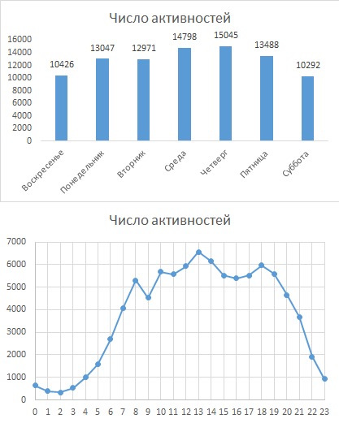

## Задание 1

```sql
WITH user_max_day AS (
    SELECT
        u.id                                         AS user_id,
        DATE_TRUNC('month', u.date_joined)::date     AS cohort_month,
        MAX(DATE(ue.entry_at) - DATE(u.date_joined)) AS max_day
    FROM users u
    LEFT JOIN userentry ue
        ON ue.user_id = u.id
       AND ue.entry_at >= u.date_joined
    GROUP BY u.id, u.date_joined
),
cohort_size AS (
    SELECT cohort_month, COUNT(*) AS users_total
    FROM user_max_day
    GROUP BY cohort_month
),
retention AS (
    SELECT
        c.cohort_month,
        c.users_total,
        n.n_days,
        COUNT(*) FILTER (WHERE m.max_day >= n.n_days) AS users_retained
    FROM cohort_size c
    JOIN user_max_day m ON m.cohort_month = c.cohort_month
    CROSS JOIN (VALUES (0),(1),(3),(7),(14),(30),(60),(90)) AS n(n_days)
    GROUP BY c.cohort_month, c.users_total, n.n_days
)
SELECT
    cohort_month,
    users_total,
    n_days,
    users_retained,
    ROUND(users_retained::numeric / NULLIF(users_total, 0), 4) AS rolling_retention
FROM retention
ORDER BY cohort_month, n_days;
```

**Выводы:**

1. **Форма кривой.** У репрезентативных когорт (ноябрь 2021 – февраль 2022) кривая retention резко падает с D0 (83–92%) до D1 (28–65%), после чего продолжает снижаться без выраженного выполаживания. У когорты ноября 2021 намечается ядро (27–37% на D60–D90), у когорты февраля 2022 ядра нет (1% на D90). Это означает: продукт пока не формирует устойчивого ядра лояльных пользователей; годовая подписка рискованна для массовой аудитории.

2. **Деградация когорт.** D30 падает с 47% (ноябрь 2021) до 7–9% (март–апрель 2022) при росте размера когорты с 210 до 1058 человек. Это деградация удержания: чем больше масштаб привлечения, тем хуже удержание. Гипотезы: расширение каналов (менее целевая аудитория), сезонность (январь–февраль), проблемы онбординга. Рекомендуется исследовать источники трафика и качество онбординга до запуска подписки — иначе подписка не окупится на новых когортах.

3. **Ограничение окна наблюдения.** Выгрузка сделана 24.05.2022 (`MAX(entry_at)`). Для когорт марта–апреля 2022 окно наблюдения < 60/90 дней, поэтому D60/D90 для них занижены и несопоставимы с ранними когортами. D30 достоверен для всех когорт (30 < 53 дней) — на нём и построен вывод о деградации.

4. **Влияние на выбор срока подписки.** Основная активность — первые 1–7 дней (D1–D7 = 14–65%). Устойчивого ядра на 90 дней нет (кроме частично ноября 2021). Это поддерживает краткосрочную подписку (неделя/месяц) как основной продукт. Годовую подписку со скидкой имеет смысл предлагать только узкому сегменту (например, пользователям с высокой активностью в первые 30 дней) — как «премиум для ядра», а не как массовый продукт.

5. **Аномалия данных.** 15 записей в `userentry` имеют `entry_at < date_joined` (вход до регистрации) — исключены из расчёта дня активности; пользователи при этом остаются в знаменателе когорт.

   ## Задание 2

```sql
WITH user_balance AS (
    SELECT
        u.id AS user_id,
        COALESCE(SUM(CASE WHEN t.type_id NOT IN (1,23,24,25,26,27,28,30)
                          THEN t.value ELSE 0 END), 0) AS total_credited,
        COALESCE(SUM(CASE WHEN t.type_id IN (1,23,24,25,26,27,28,30)
                          THEN t.value ELSE 0 END), 0) AS total_debited
    FROM users u
    LEFT JOIN transaction t ON t.user_id = u.id
    GROUP BY u.id
),
balances AS (
    SELECT user_id, total_credited, total_debited,
           total_credited - total_debited AS balance
    FROM user_balance
)
SELECT
    ROUND(AVG(total_debited)::numeric, 2) AS avg_debited_per_user_all,
    ROUND(AVG(total_debited) FILTER (WHERE total_debited > 0)::numeric, 2) AS avg_debited_per_user_active,
    ROUND(AVG(total_credited)::numeric, 2) AS avg_credited_per_user_all,
    ROUND(AVG(total_credited) FILTER (WHERE total_credited > 0)::numeric, 2) AS avg_credited_per_user_active,
    ROUND(AVG(balance)::numeric, 2) AS avg_balance_all,
    ROUND(PERCENTILE_CONT(0.5) WITHIN GROUP (ORDER BY balance)::numeric, 2) AS median_balance_all
FROM balances;
```

**Выводы:**
1.	Средние vs медианные показатели. Средний баланс (238 коинов) в 4 раза выше медианного (56 коинов) — распределение балансов сильно скошено вправо: небольшая группа «китов» (максимум 25 203 коина) тянет среднее вверх, а у типичного пользователя всего ~56 коинов. Для ценообразования подписки ориентироваться нужно на медиану (56), а не на среднее.
2.	Начисления превышают списания. Среднее начисление (265 коинов) значительно выше среднего списания (27 коинов; 76 — среди тех, кто тратит). Основные начисления — «бесплатные» (за регистрацию, ежедневный вход, достижения), а не покупки за деньги. Это подтверждает проблему текущей модели: коины накапливаются, а не тратятся, монетизация неэффективна.
3.	Низкая интенсивность трат. Даже активные пользователи тратят в среднем ~76 коинов за всё время. При курсе ~1 коин ≈ 1 руб. это ~76 руб. — слишком мало для подписки. Текущая модель не стимулирует покупку коинов.
4.	Покрытие транзакциями. 86.6% пользователей (2402 из 2774) имеют хотя бы одну транзакцию; 13.4% — ни одной (вероятно, «мёртвые» регистрации или технические аккаунты).
5.	Аномалия. Минимальный баланс = −89 коинов (уход в минус) — edge-case, требующий проверки (баг, возврат или списание без баланса).
6.	Влияние на стоимость подписки. Учитывая медианный баланс 56 коинов и низкую интенсивность трат, текущая стоимость коинов не является ориентиром для подписки. Подписку стоит позиционировать как доступ к премиум-функциям (топовые задачи, кейсы, вопросы), а не как «пакет коинов». Цену подписки разумно привязать к медианному балансу (56 коинов ≈ 56 руб.) как к «нижней границе», а среднему (238) — как к «верхней» для сегмента активных.

   ## Задание 3

### Блок A — метрики активности

```sql
WITH users_total AS (
    SELECT COUNT(*) AS cnt FROM users
),
user_tasks AS (
    SELECT user_id,
           COUNT(DISTINCT problem_id) AS tasks_solved,
           COUNT(*)                   AS submit_attempts
    FROM codesubmit
    GROUP BY user_id
),
user_tests AS (
    SELECT user_id,
           COUNT(DISTINCT test_id) AS tests_started,
           COUNT(*)                AS test_attempts
    FROM teststart
    GROUP BY user_id
),
active_users AS (
    SELECT user_id FROM codesubmit WHERE is_false = 0
    UNION
    SELECT user_id FROM teststart
)
SELECT
    ROUND((SELECT AVG(tasks_solved)::numeric FROM user_tasks), 2)       AS avg_tasks_per_user,
    ROUND((SELECT AVG(tests_started)::numeric FROM user_tests), 2)      AS avg_tests_per_user,
    ROUND((SELECT SUM(submit_attempts)::numeric / NULLIF(SUM(tasks_solved), 0) FROM user_tasks), 2) AS avg_attempts_per_task,
    ROUND((SELECT SUM(test_attempts)::numeric / NULLIF(SUM(tests_started), 0) FROM user_tests), 2) AS avg_attempts_per_test,
    ROUND((SELECT COUNT(*)::numeric FROM active_users) / (SELECT cnt FROM users_total), 4) AS share_active_users;
```

Результат: `9.52 | 1.68 | 2.90 | 1.26 | 0.5905`

### Блок B — покупки за кодкоины

```sql
WITH purchases AS (
    SELECT t.user_id, t.type_id, COUNT(*) AS cnt
    FROM transaction t
    WHERE t.type_id IN (23,24,25,26,27,28)
    GROUP BY t.user_id, t.type_id
),
by_category AS (
    SELECT
        COUNT(DISTINCT user_id) FILTER (WHERE type_id = 23)          AS users_bought_tasks,
        COUNT(DISTINCT user_id) FILTER (WHERE type_id IN (26,27,28)) AS users_bought_tests,
        COUNT(DISTINCT user_id) FILTER (WHERE type_id = 24)          AS users_bought_hints,
        COUNT(DISTINCT user_id) FILTER (WHERE type_id = 25)          AS users_bought_solutions,
        SUM(cnt) FILTER (WHERE type_id = 23)                         AS facts_tasks,
        SUM(cnt) FILTER (WHERE type_id IN (26,27,28))                AS facts_tests,
        SUM(cnt) FILTER (WHERE type_id = 24)                         AS facts_hints,
        SUM(cnt) FILTER (WHERE type_id = 25)                         AS facts_solutions
    FROM purchases
),
totals AS (
    SELECT COUNT(DISTINCT user_id) AS users_bought_any, SUM(cnt) AS facts_total
    FROM purchases
),
users_with_tx AS (
    SELECT COUNT(DISTINCT user_id) AS users_tx FROM transaction
)
SELECT
    b.users_bought_tasks,
    b.users_bought_tests,
    b.users_bought_hints,
    b.users_bought_solutions,
    (COALESCE(b.facts_tasks,0) + COALESCE(b.facts_tests,0) + COALESCE(b.facts_hints,0) + COALESCE(b.facts_solutions,0)) AS facts_open_total,
    t.users_bought_any,
    u.users_tx
FROM by_category b
CROSS JOIN totals t
CROSS JOIN users_with_tx u;
```

Результат: `522 | 676 | 53 | 151 | 3205 | 1139 | 2402`

**Выводы:**
Активность
Задачи — ядро продукта. Средний активный пользователь решает 9.5 задач, но проходит лишь 1.7 теста (разница в 5.7 раза). Тесты — второстепенный функционал с низкой вовлечённостью.

Задачи требуют усилий. В среднем 2.9 попытки на одну задачу (сабмиты «Проверить»). Это естественная «боль» пользователя — хороший рычаг для монетизации: ограничение числа попыток в бесплатной версии (например, 3–5 бесплатно, дальше подписка).

Тесты проходят «с первого раза» (1.26 попытки) — низкая вовлечённость, люди не возвращаются.

59% пользователей активны (решали задачу или начинали тест); 41% — «мёртвая» аудитория. Целевая аудитория подписки — эти 59%.

Покупки за коины
Тесты покупают чаще задач (676 vs 522 человек), хотя решают их реже. Парадокс: тесты — «разовые» покупки, задачи люди решают бесплатно.

Подсказки — самая непопулярная покупка (53 человека). Плохой кандидат в платную подписку; хороший — в бесплатную (как «завлекалочка»).

Решения покупают 151 человек — умеренный спрос.

1139 из 2402 транзакционных пользователей (47.4%) хоть раз что-то покупали; 52.6% — только получали начисления, ничего не тратили. Подтверждает проблему: половина пользователей не тратит коины.

3205 фактов открытия на 1139 покупателей = ~2.8 покупки на покупателя — есть «активные покупатели», ядро платящей аудитории.

Что включать в подписку
Задачи — основа (высокая активность, 522 покупателя). В бесплатной версии — ограниченное число задач/попыток; в подписке — безлимит + топовые задачи от компаний.

Тесты — в подписку как «премиум-контент» (676 покупателей — самый высокий спрос на покупку), но не как основную ценность.

Подсказки — в бесплатную версию (низкий спрос, 53 человека), как «завлекалочка».

Решения — в подписку (151 покупатель, умеренный спрос) как «премиум-функция».

Ограничение попыток (2.9 в среднем) — естественный рычаг: 3–5 бесплатных попыток, дальше подписка.

## Дополнительное задание

Мне кажется, для решения вопросов IT Resume (срок, цена, состав подписки) полезны три метрики, которые показывают «платёжеспособность» аудитории, «точку боли» и «окно вовлечённости». Для этого я предлагаю посчитать:

### Метрика 1. Доля пользователей, чей баланс позволяет купить хотя бы одну задачу

**Почему полезна:**

* Показывает, насколько текущая модель монетизации эффективна: если у большинства баланс достаточный — люди покупают без реальных денег.
* Обосновывает цену подписки: если 77% могут купить за коины, подписка должна давать то, чего за коины не купить.
* Показывает потенциал «докупания» коинов для тех, у кого баланса не хватает.

**Код:**

```sql
WITH user_balance AS (
    SELECT u.id,
           COALESCE(SUM(CASE WHEN t.type_id NOT IN (1,23,24,25,26,27,28,30) THEN t.value ELSE 0 END), 0)
         - COALESCE(SUM(CASE WHEN t.type_id IN (1,23,24,25,26,27,28,30) THEN t.value ELSE 0 END), 0) AS balance
    FROM users u
    LEFT JOIN transaction t ON t.user_id = u.id
    GROUP BY u.id
),
task_price AS (
    SELECT PERCENTILE_CONT(0.5) WITHIN GROUP (ORDER BY value) AS median_task_price
    FROM transaction WHERE type_id = 23
)
SELECT
    (SELECT median_task_price FROM task_price) AS median_task_price,
    COUNT(*) FILTER (WHERE balance >= (SELECT median_task_price FROM task_price)) AS users_can_afford,
    COUNT(*) AS users_total,
    ROUND(COUNT(*) FILTER (WHERE balance >= (SELECT median_task_price FROM task_price))::numeric / COUNT(*), 4) AS share_can_afford
FROM user_balance;
```

**Выводы:** медианная цена задачи — 30 коинов; 77% пользователей (2136 из 2774) имеют баланс ≥ 30, то есть могут покупать, не тратя реальные деньги. Это подтверждает неэффективность текущей модели: большинство живёт на бесплатных начислениях. Подписка должна давать то, чего за коины не купить (безлимит, топовые задачи, разделы), иначе она не нужна.

### Метрика 2. После скольких попыток люди бросают задачу, не решив

**Почему полезна:**

* Показывает «точку боли» — момент, когда пользователь сдаётся.
* Напрямую обосновывает состав подписки: ограничение числа попыток как рычаг монетизации.
* Помогает выбрать оптимальный лимит бесплатных попыток (3–5).

**Код:**

```sql
WITH per_task_user AS (
    SELECT user_id, problem_id,
           COUNT(*) AS attempts,
           MAX(CASE WHEN is_false = 0 THEN 1 ELSE 0 END) AS solved
    FROM codesubmit
    GROUP BY user_id, problem_id
)
SELECT
    CASE
        WHEN attempts = 1 THEN '1 попытка'
        WHEN attempts BETWEEN 2 AND 3 THEN '2-3 попытки'
        WHEN attempts BETWEEN 4 AND 5 THEN '4-5 попыток'
        ELSE '6+ попыток'
    END AS attempts_bucket,
    COUNT(*) FILTER (WHERE solved = 0) AS unsolved_cases,
    COUNT(*) AS total_cases,
    ROUND(COUNT(*) FILTER (WHERE solved = 0)::numeric / COUNT(*), 4) AS share_unsolved
FROM per_task_user
GROUP BY attempts_bucket
ORDER BY attempts_bucket;
```

**Выводы:** 78.5% случаев — 1–3 попытки; доля бросивших растёт с числом попыток (7.6% → 14.0% на 6+). Ограничение в 3–5 попыток — разумный рычаг: большинство укладывается, а «упорные» (6+) — целевая аудитория подписки. Слишком жёсткий лимит (1 попытка) отпугнёт.

### Метрика 3. Когда происходит первая покупка за коины

**Почему полезна:**

* Обосновывает срок подписки: если пик покупок — день регистрации, краткосрочная подписка имеет смысл.
* Показывает окно вовлечённости для маркетинга (продажа подписки в первый день).
* Помогает понять, «сгорают» ли люди быстро или возвращаются.

**Код:**

```sql
WITH first_purchase AS (
    SELECT t.user_id, MIN(t.created_at) AS first_purchase_at
    FROM transaction t
    WHERE t.type_id IN (23,24,25,26,27,28)
    GROUP BY t.user_id
)
SELECT
    CASE
        WHEN DATE(fp.first_purchase_at) - DATE(u.date_joined) = 0 THEN 'в день регистрации'
        WHEN DATE(fp.first_purchase_at) - DATE(u.date_joined) BETWEEN 1 AND 7 THEN '1-7 дней'
        WHEN DATE(fp.first_purchase_at) - DATE(u.date_joined) BETWEEN 8 AND 14 THEN '8-14 дней'
        WHEN DATE(fp.first_purchase_at) - DATE(u.date_joined) BETWEEN 15 AND 30 THEN '15-30 дней'
        ELSE '30+ дней'
    END AS days_bucket,
    COUNT(*) AS users_cnt,
    ROUND(COUNT(*)::numeric / SUM(COUNT(*)) OVER (), 4) AS share
FROM first_purchase fp
JOIN users u ON u.id = fp.user_id
GROUP BY days_bucket
ORDER BY days_bucket;
```

**Выводы:** 83.4% первых покупок — в день регистрации. Дальше резкий спад: 9% в первую неделю, единицы позже. Пик вовлечённости — день регистрации — идеальное окно для продажи подписки (пробный период, скидка на первый месяц). Недельная подписка имеет смысл; годовая — только для ядра (4% покупают после 30 дней).

## Дополнительное задание 2

Для выгрузки данных используем SQL-запрос:

```sql
SELECT
    EXTRACT(DOW FROM activity_at)::int AS dow,
    COUNT(*) AS activity_cnt
FROM (
    SELECT entry_at AS activity_at FROM userentry
    UNION ALL SELECT created_at FROM coderun
    UNION ALL SELECT created_at FROM codesubmit
    UNION ALL SELECT created_at FROM teststart
) a
GROUP BY dow
ORDER BY dow;
```

```sql
SELECT
    EXTRACT(HOUR FROM activity_at)::int AS hour,
    COUNT(*) AS activity_cnt
FROM (
    SELECT entry_at AS activity_at FROM userentry
    UNION ALL SELECT created_at FROM coderun
    UNION ALL SELECT created_at FROM codesubmit
    UNION ALL SELECT created_at FROM teststart
) a
GROUP BY hour
ORDER BY hour;
```

**Python-код:** Python не изучался в рамках курса, поэтому график построен в Excel по агрегированным данным из SQL-запросов выше. Данные выгружены в CSV и визуализированы в виде столбчатой диаграммы (по дням недели) и линейного графика (по часам).

**Результат по дням недели:**

| День | Активностей |
|---|---|
| Вс | 10 426 |
| Пн | 13 047 |
| Вт | 12 971 |
| Ср | 14 798 |
| Чт | 15 045 |
| Пт | 13 488 |
| Сб | 10 292 |

**Результат по часам:**

| Час | Активностей |
|---|---|
| 0 | 638 |
| 1 | 387 |
| 2 | 326 |
| 3 | 532 |
| 4 | 1 007 |
| 5 | 1 582 |
| 6 | 2 696 |
| 7 | 4 052 |
| 8 | 5 299 |
| 9 | 4 522 |
| 10 | 5 680 |
| 11 | 5 563 |
| 12 | 5 935 |
| 13 | 6 552 |
| 14 | 6 144 |
| 15 | 5 515 |
| 16 | 5 393 |
| 17 | 5 511 |
| 18 | 5 974 |
| 19 | 5 583 |
| 20 | 4 645 |
| 21 | 3 688 |
| 22 | 1 915 |
| 23 | 928 |



**Выводы:** Рекомендую проводить релизы **в понедельник или вторник, в 5:00–7:00 утра**, потому что:
* В эти дни активность умеренная (13 000), а пик — в среду–четверг (14 800–15 000). Функционал успеет «обкататься» до максимальной нагрузки.
* В 5:00–7:00 активность минимальна (1 500–2 700 против 6 500 в пик 13:00) — если что-то сломается, затронет минимум пользователей.
* Хуже всего релизить в пятницу/выходные (10 300–13 500, минимум суббота 10 292) — баги «доживут» до понедельника, когда люди вернутся, а чинить придётся в минимальной активности.
* Избегать релизов в 13:00–14:00 и 18:00 (пики 6 500 и 6 000) — любой сбой затронет максимум пользователей.


  ## Итоговые выводы по смене модели монетизации

На основе анализа данных (retention, балансы, активность, покупки) можно сформулировать конкретные рекомендации по переходу от CodeCoins к подписке.

### 1. Срок подписки

**Рекомендация: гибридная модель — месячная подписка как основная + годовая со скидкой для ядра.**

Почему:
* **Rolling retention резко падает в первые дни**: с D0 (83–92%) до D1 (28–65%), и **не выполаживается** — устойчивого ядра на 90 дней нет (у когорты февраля 2022 на D90 остаётся 1%). Это значит, что **годовая подписка рискованна для массовой аудитории**: большинство уйдёт через месяц, а год со скидкой = убыток.
* **Но у части когорт (ноябрь 2021) ядро есть**: 27–37% на D60–D90. Это сегмент, которому **годовая подписка имеет смысл** — как «премиум для лояльных».
* **83.4% первых покупок происходят в день регистрации** — пик вовлечённости в первый день. **Недельная/месячная подписка** «поймает» этот пик; годовая — нет.
* **Деградация когорт**: D30 падает с 47% (ноябрь 2021) до 7–9% (март–апрель 2022). Новые пользователи удерживаются хуже — годовая подписка на них не окупится.

**Итог:** месячная подписка — основной продукт; годовая — со скидкой 30–50% только для сегмента с высокой активностью в первые 30 дней (например, решил 10+ задач).

### 2. Стоимость подписки

**Рекомендация: месячная подписка — в диапазоне 150–250 руб., годовая — 1 200–1 800 руб. (со скидкой ~40%).**

Почему:
* **Медианный баланс — 56 коинов (≈ 56 руб.)**, средний — 238 коинов (≈ 238 руб.). Медиана важнее: она отражает «типичного» пользователя, а среднее завышено «китами» (максимум 25 203 коина).
* **77% пользователей имеют баланс ≥ 30 коинов** (медианная цена задачи) — то есть большинство **может покупать, не тратя реальные деньги**. Подписка должна давать то, чего за коины не купить (безлимит, топовые задачи, разделы), иначе она не нужна.
* **Среднее списание — 27 коинов (все) / 76 коинов (активные)**. Это **нижняя граница** готовности платить: пользователь, тратящий 76 коинов за всё время, вряд ли заплатит 500 руб./мес. Цена должна быть **соизмерима** с текущими тратами.
* **Среднее начисление — 265 коинов**, но это «бесплатные» коины за активность. Подписка не должна конкурировать с ними — она должна **дополнять** (премиум-функции).

**Итог:** 150–250 руб./мес — «психологически комфортная» цена (соизмерима с медианным балансом 56 руб. + готовность платить за премиум). Годовая — 1 200–1 800 руб. (скидка ~40% к месячной).

### 3. Состав подписки

**Рекомендация: включить в подписку безлимит задач + топовые задачи + доступ к разделам; ограничить попытки в бесплатной версии; подсказки — в бесплатную.**

Почему:
* **Задачи — ядро продукта**: средний активный пользователь решает 9.5 задач, но проходит лишь 1.7 теста (разница в 5.7 раза). Тесты — второстепенны.
* **2.9 попытки на задачу** — естественная «боль». **Ограничение 3–5 попыток** в бесплатной версии — рычаг монетизации: 78.5% случаев укладываются в 1–3 попытки, а «упорные» (6+) — целевая аудитория подписки.
* **Покупки за коины**: тесты покупают чаще задач (676 vs 522 человек), подсказки — реже всего (53). **Подсказки — в бесплатную** (низкий спрос, «завлекалочка»), **решения — в подписку** (151 покупатель, умеренный спрос).
* **59% пользователей активны** (решали задачу или начинали тест) — целевая аудитория подписки. 41% — «мёртвая» аудитория, на них не ориентируемся.
* **52.6% транзакционных пользователей ничего не тратили** — подтверждает: текущая модель не стимулирует траты. Подписка должна давать **новую ценность**, а не «пакет коинов».

**Итог:**
* **Бесплатно:** базовые задачи (ограниченное число), 3–5 попыток на задачу, подсказки, тесты (ограниченно).
* **Подписка:** безлимит задач, безлимит попыток, топовые задачи от компаний, доступ к кейсам/вопросам, решения.
* **Годовая со скидкой:** то же + приоритетная поддержка / эксклюзивный контент для ядра.

### 4. Что учесть при запуске

* **Пик вовлечённости — день регистрации** (83.4% первых покупок). Идеальное окно для **продажи подписки**: пробный период 7 дней или скидка на первый месяц.
* **Деградация когорт** (D30 с 47% до 7–9%) — сигнал, что **качество привлечения падает**. До запуска подписки стоит разобраться с каналами трафика и онбордингом, иначе подписка не окупится на новых когорт.
* **Релизы — в понедельник/вторник, 5:00–7:00** (минимальная активность, запас до пика среды–четверга). Избегать пятницы/выходных и пиков 13:00–14:00, 18:00.

### Итоговая рекомендация

Я считаю, что IT Resume нужно сделать так: **месячная подписка 150–250 руб. как основной продукт + годовая 1 200–1 800 руб. со скидкой для ядра**. В бесплатной версии — базовые задачи с ограничением 3–5 попыток и подсказки; в подписке — безлимит, топовые задачи, кейсы, решения. Запуск — с пробным периодом в день регистрации (пик вовлечённости), после аудита каналов трафика (деградация когорт). А ещё, беря во внимание низкий медианный баланс (56 коинов) и то, что 77% могут покупать за коины, — подписка должна давать **то, чего за коины не купить**, иначе она не будет востребована.
