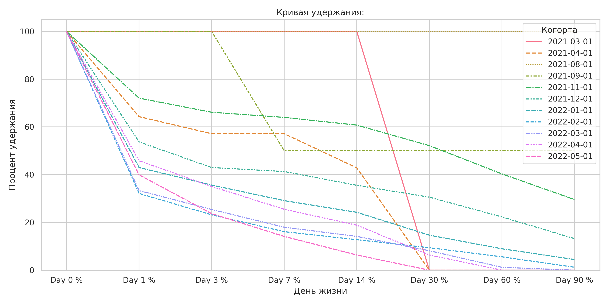
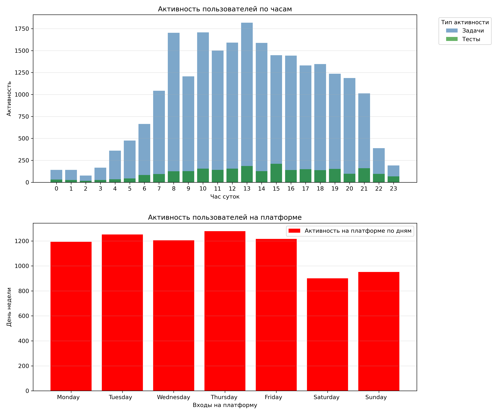

# ЗАДАНИЕ 1

- Расчет rolling retention с разбивкой по когортам. 
- В качестве когорт берем месяц регистрации на платформе. 
- В качестве n-дней - 0, 1, 3, 7, 14, 30, 60 и 90 дней.

## Решение PSQL 
[download SQL](SF_final_task_1.sql)

```sql

-- в задании рекомендуется брать дату первого входа как дату регистрации из таблицы users
-- но при проверке MIN значения даты из таблицы userentry стало понятно, что это одно и тоже
-- поэтому я отказался от лишнего JOIN и сделал все через userentry

$$ -- сравниваем дату регистрации из [users] и минимальную дату входа из [userentry]
select
	u.id,
	u.date_joined::date,
	MIN(ue.entry_at::date) as first_login_date	
from users u
join userentry ue on u.id = ue.user_id
group by u.id, u.date_joined::date
$$

-- Используем временные таблицы для приведения к нужным данным
with first_login as ( -- Что получили на выходе скрипта:1. Найдем дату первого входа для каждого пользователя
	select 
		u.user_id,
		MIN(u.entry_at::date) as first_login_date,
		date_trunc('month', MIN(u.entry_at::date))::date as cohort_month
	from userentry u
	group by u.user_id
	order by first_login_date asc
),
user_activ as ( -- 2.Считаем разницу дней между первым входом и каждым последующим
	select
		u.user_id,
		f.cohort_month,
		(u.entry_at::date - f.first_login_date) as day_diff
	from userentry u
	join first_login f on u.user_id = f.user_id
	group by u.user_id, f.cohort_month, (u.entry_at::date - f.first_login_date)
),
cohort_size as ( -- 3.Посчитаем уникальных пользователей в каждой когорте
	select
		cohort_month,
		count(distinct user_id) as total_user
		from first_login
		group by cohort_month
)
select -- 4. Формируем итоговый запрос для каждой когорты
	c.cohort_month as "month_cohort",
	c.total_user as "count_users",
	round(count(distinct case when a.day_diff >= 0 then a.user_id end) * 100.0 / c.total_user, 2) as "Day 0 %",
	round(count(distinct case when a.day_diff >= 1 then a.user_id end) * 100.0 / c.total_user, 2) as "Day 1 %",
	round(count(distinct case when a.day_diff >= 3 then a.user_id end) * 100.0 / c.total_user, 2) as "Day 3 %",
	round(count(distinct case when a.day_diff >= 7 then a.user_id end) * 100.0 / c.total_user, 2) as "Day 7 %",
	round(count(distinct case when a.day_diff >= 14 then a.user_id end) * 100.0 / c.total_user, 2) as "Day 14 %",
	round(count(distinct case when a.day_diff >= 30 then a.user_id end) * 100.0 / c.total_user, 2) as "Day 30 %",
	round(count(distinct case when a.day_diff >= 60 then a.user_id end) * 100.0 / c.total_user, 2) as "Day 60 %",
	round(count(distinct case when a.day_diff >= 90 then a.user_id end) * 100.0 / c.total_user, 2) as "Day 90 %"
from cohort_size c
left join user_activ a on c.cohort_month = a.cohort_month
group by c.cohort_month, c.total_user
order by c.cohort_month
```


## Полученный результат скрипта
[download CSV](result_psql_tsk_1.csv)


## Код Python для визуализации когортного анализа 
[download PY](sf-finale-project.py)

```python
import pandas as pd
import matplotlib.pyplot as plt
import seaborn as sns
df = pd.read_csv('Result_PSQL.csv')
df_plot = df.drop(columns=['count_users'])
df_plot = df_plot.set_index('month_cohort')
sns.set_theme(style='whitegrid')
plt.figure(figsize=(12,6))
sns.lineplot(data=df_plot.T)
plt.title('Кривая удержания:')
plt.xlabel('День жизни')
plt.ylabel('Процент удержания')
plt.ylim(0,105)
plt.legend(title='Когорта', loc='upper right')
plt.tight_layout()
plt.savefig('retention_curve.png',dpi=300)
plt.show()
```
## Полученный результат Python - скрин с графиком 


## Выводы
У меня получилось всего 11 строк-месяцев, этого мало для качественной оценки. Но если судить по имеющейся информации, то нужно сделать подписку 14 дней, т.к. там происходит излом, после которой начинают уходить пользователи

# ЗАДАНИЕ 2

Расчет метрик относительно баланса пользователя:

- сколько в среднем коинов списывает 1 человек
- сколько в среднем коинов начисляется 1 человеку
- какой средний баланс среди всех пользователей
- какой медианный баланс среди всех пользователей

## Решение PSQL 
[download SQL](SF_final_task_2.sql)

```sql
-- рекомендуется использовать данные из таблиц transaction и transactiontype
-- но у нас в таблице transaction уже есть type_id и мы знаем из задачи значения для фильтрации,
-- так что в решении я сделаю без объединения таблиц.

-- Если бы у нас не были заданы type_id, можно было сделать фильтр по ключевым словам:
-- сJOINить две таблицы (transaction и transactiontype) + и добавить условие "where t2.description like 'Купить%' or t2.description like 'покупка%' or t2.description like 'Списание')"


with table_transaction as (
	select
		user_id,
		sum(value) as user_value, --сразу сгруппируем списания/пополнения каждого пользователя
		case -- добавим параметр с указанием типа операции списания(spend_coin) и начисления (receive_coin)
			when type_id in (1,23,24,25,26,27,28,30) then 'spend_coin' --это все списания
			else 'receive_coin' -- это все начисления
		end type_transaction
	from transaction
	group by user_id, type_transaction 
	order by user_id
),
avg_transactions as(
	select
		round(sum(case when type_transaction='spend_coin' then user_value end)/count(case when type_transaction='spend_coin' then 1 end),0) as "В среднем списывает 1 чел.",
		round(sum(case when type_transaction='receive_coin' then user_value end)/count(case when type_transaction='receive_coin' then 1 end),0) as "В средним начисляется 1 чел.",
		round((sum(case when type_transaction='receive_coin' then user_value end) - sum(case when type_transaction='spend_coin' then user_value end))/count(distinct user_id),0) as "Средний баланс среди всех"
	from table_transaction
),
balance_users as (
	select
		user_id,
		sum(case when type_transaction='receive_coin' then user_value else 0 end) - sum(case when type_transaction='spend_coin' then user_value else 0 end) as balance_user
	from table_transaction
	group by user_id
),
median_balance as (
	select
		percentile_cont(0.5) WITHIN GROUP (ORDER BY balance_user) AS "Медианный баланс среди всех" 
	FROM balance_users
)
select *
from avg_transactions
cross join median_balance 
```

## Полученный результат скрипта
[download CSV](result_psql_tsk_2.csv)


## Выводы
Подписку стоит сделать на 60 коинов, так как это медианный баланс среди всех пользователей и примерно столько же в среднем списывает 1 человек.


# ЗАДАНИЕ 3

Расчет метрик активности пользователей на платформе:
- Сколько в среднем пользователь решает задач
- Сколько в среднем пользователь проходит тестов
- Сколько в среднем пользователь делает попыток для решения 1 задачи
- Сколько в среднем пользователь делает попыток для прохождения 1 теста

Дополнительно важно оценить:
- Какая доля от общего числа пользователей решала хотя бы одну задачу или начинала проходить хотя бы один тест

Плюс еще информация по покупкам материалов на платформе за кодкоины - эти 6 чисел нужно вывести 1 запросом, чтобы было наглядно:
- Сколько человек открывало задачи за кодкоины
- Сколько человек открывало тесты за кодкоины
- Сколько человек открывало подсказки за кодкоины
- Сколько человек открывало решения за кодкоины
- Сколько подсказок/тестов/задач/решений было открыто за кодкоины (если задача/... открыта разными людьми, то это считаем разными фактами открытия)
- Сколько человек покупало хотя бы что-то из вышеперечисленного
- Сколько человек всего имеют хотя бы 1 транзакцию, пусть даже только начисление

		
## Решение PSQL 
[download SQL](SF_final_task_3.sql)

```sql
-- Задачу буду решать через несколько подзапросов и потом сведу все в один select


with problem_table_1 as( -- в таблице codesubmit информация по попыткам отправить решение, из которых is_false=0 успешные (готовое решение)
	select
		(count(problem_id) filter (where is_false=0))/count(distinct user_id) as "В среднем 1 ученик решает задач",
		count(problem_id)/count(distinct user_id) as "В среднем попыток решить задачу"
	from codesubmit
),
problem_table_2 as ( -- в таблице coderun информация по проверкам кода. Это не попытки отправить решение, их не считаем в ответе, но активность отследим
	select
		count(problem_id)/count(distinct user_id) as "В среднем 1 ученик проверяет код"
	from coderun
),
test_table as (
	select
		round(sum(total_test)/count(user_id),1) as "В среднем попыток пройти тест",
		round(sum(test_pos)/count(user_id),1) as "В среднем 1 ученик проходит тестов"
	from (
		select --в подзапросе сгруппируем по каждому ученику его количество попыток и количество пройденых тестов
			user_id,
			count(test_id) as total_test,
			count(distinct test_id) as test_pos --у нас нет параметра для успешного теста, поэтому считаем успешным каждый последний тест
		from teststart
		group by user_id
	) as test_users
),
active_users as (
	select -- тут мы соединяем уже три таблицы users + codesubmit + teststart
		count(distinct users.user_id) filter (where users.problem_id is not null or t.test_id is not null) as "Кол-во учеников решали задачи или тест",
		(count(distinct users.user_id) filter (where users.problem_id is not null or t.test_id is not null))*100/(count (distinct users.user_id)) as "% учеников решали задачу или тест"
	from (
		select -- в подзапросе соединим таблицы users + codesubmit чтобы попали ученики кто не решал задач, но есть на платформе
			u.id as user_id,
			cs.problem_id as problem_id
		from users u
		left join codesubmit cs on u.id = cs.user_id
		order by user_id
		) as users
	left join teststart t on users.user_id = t.user_id
),
transaction_users as (
	select -- соединем таблицы users + transaction и собираем данные по всем транзакциям
		count (distinct u.id) as "Всего пользователей",
		count (distinct u.id) filter (where t.type_id in (23)) as "Человек купило задачи",
		count (distinct u.id) filter (where t.type_id in (27)) as "Человек купило тесты",
		count (distinct u.id) filter (where t.type_id in (24)) as "Человек купило подсказки",
		count (distinct u.id) filter (where t.type_id in (25)) as "Челвоек купило решения",
		count (t.type_id) filter (where t.type_id in (23,27,24,25)) as "Всего было открыто",
		count (distinct u.id) filter (where t.type_id in (23,27,24,25)) as "Кто купил что-то из этого",
		count (distinct u.id) filter (where t.type_id is not null) as "Людей с 1+ транзакцией"
	from users u
	left join transaction t on u.id = t.user_id
)
select * -- собираем все таблицы в одну для ответа
from problem_table_1
cross join problem_table_2
cross join test_table 
cross join active_users
cross join transaction_users
```

## Полученный результат скрипта 
[download CSV](result_psql_tsk_3.csv)
Для удобства чтения транспонировал таблицу


## Выводы 
У нас 61% пользователей, которые проявляли после регистрации активность на платформе, проходили тесты или решали задачи. При этом популярные услуги - Покупка задач (46%) и Покупка тестов (59%), но не популярны Покупка подсказок (5%) и Покупка решений (13%). Поэтому я бы рекомендовал в подписку включить покупку задач и покупку тестов

	
# Дополнительное задание 1

Проведем дополнительные исследования для поиска полезных метрик
	
## Исследование 1. Статистика списания токенов 
[download SQL](SF_final_task_add.sql)

```sql
-- Проверим статистику списания токенов
select
	--t2.type_id as "",
	t2.description as "Тип списания",
	count(t.value) as "Количество",
	round(100*count(t.value)/sum(count(t.value)) over(),1) as "%",
	sum(t.value) as "Общая сумма",
	round(100*sum(t.value)/sum(sum(t.value)) over(),1) as "%"
from transaction t
join transactiontype t2 on t.type_id = t2.type
where t.type_id in (1, 23, 24, 25, 26, 27, 28, 30)
group by t.type_id, t2.description
order by count(t.value)
```
## Полученный результат 
[download CSV](Statistic_spend_coin.csv)


## Выводы
Аномальных выбросов нет. Но можно заметить что часть операций с высоким количеством операций приносит меньший % сжигания коинов. Я бы предложил пересмотреть стоимость операций списания, чтобы быстрее сжигать залежавшиеся коины.

## Исследование 2.Статистика начисления коинов
```sql	
-- Теперь проверим статистику начислений коинов от платформы
-- я исключил из всех начислений операцию Найти баг, т.к. их всего 0.31%, но сумма начислений 53.09% и этот выброс портит статистику для анализа
-- и исключил покупку коинов за деньги, т.к. это и есть наша цель повысить покупки коинов
select
	--t2.type_id as "",
	t2.description as "Тип начисления",
	count(t.value) as "Количество",
	round(100*count(t.value)/sum(count(t.value)) over(),2) as "%",
	sum(t.value) as "Общая сумма",
	round(100*sum(t.value)/sum(sum(t.value)) over(),2) as "%"
from transaction t
join transactiontype t2 on t.type_id = t2.type
where t.type_id between 2 and 22 and t.type_id <> 19 and t.type_id <> 2 
group by t.type_id, t2.description
order by count(t.value)
```
## Полученный результат 
[download CSV](Statistic_receive_coin.csv)


## Выводы
Есть аномальный выброс за операцию Регистрации, при количество 14% это дает значительную сумму в 57% от всех операций. Стоит снизить количество начисляемых коинов за регистрацию

## Исследование 3. Доля оборачиваемости коинов
```sql
-- Посмотрим долю оборачиваемости коинов
with sink_ratio as (
	select
		user_id,
		sum(value) filter(where type_id between 2 and 22) as receive_coin,
		sum(value) filter(where type_id in (1, 23, 24, 25, 26, 27, 28, 30)) as spend_coin,
		sum(value) filter(where type_id between 2 and 22) - coalesce(sum(value) filter(where type_id in (1, 23, 24, 25, 26, 27, 28, 30)),0) as balance_coin,
		100*coalesce(sum(value) filter(where type_id in (1, 23, 24, 25, 26, 27, 28, 30)),0)/(sum(value) filter(where type_id between 2 and 22)) as sink_ratio_coin
	from transaction
	group by user_id
	order by sink_ratio_coin
)
select
	100*(count(sink_ratio_coin) filter (where sink_ratio_coin = 0))/count(user_id) as "% кто не тратит коины",
	100*(count(sink_ratio_coin) filter (where sink_ratio_coin > 0 and sink_ratio_coin <=25))/count(user_id) as "% кто тратит до 25",
	100*(count(sink_ratio_coin) filter (where sink_ratio_coin > 20 and sink_ratio_coin <=50))/count(user_id) as "% кто тратит до 50%",
	100*(count(sink_ratio_coin) filter (where sink_ratio_coin > 50 and sink_ratio_coin <=75))/count(user_id) as "% кто тратит до 75%",
	100*(count(sink_ratio_coin) filter (where sink_ratio_coin > 75))/count(user_id) as "% кто тратит все коины"
from sink_ratio 
```
## Полученный результат 
[download CSV](ratio_turn_coin.csv)


## Выводы
Почти 50% не тратит токены вобще, 26% тратит не больше 50% токенов. Можно ввести временные коины, которые будут сгорать (Но только не те, которые куплены за деньги). Также можно ввести акционные предложения для тех, у кого коины залежались (например купить 25 задач со скидкой)

## Исследование 4. Первая покупка пользователя
```sql
-- Посмотрим когда пользователь совершает первую покупку
with data_date_sale as (
	select
		u.id as user,
		t2.description as transaction,
		u.date_joined::date as reg_date,
		min(t.created_at::date) - u.date_joined::date as day_first_sale
	from users u
	left join transaction t on u.id = t.user_id and t.type_id in (1, 23, 24, 25, 26, 27, 28, 30)
	left join transactiontype t2  on t.type_id  = t2.type
	where t.type_id is not null
	group by u.id, t2.description, u.date_joined::date
)
select
	100*(count(day_first_sale) filter (where day_first_sale = 0))/count(user) as "% first sale on 0 day",
	100*(count(day_first_sale) filter (where day_first_sale > 0 and day_first_sale <=1))/count(user) as "% first sale on 1 day",
	100*(count(day_first_sale) filter (where day_first_sale > 1 and day_first_sale <=7))/count(user) as "% first sale on 7 day",
	100*(count(day_first_sale) filter (where day_first_sale > 7 and day_first_sale <=14))/count(user) as "% first sale on 14 day",
	100*(count(day_first_sale) filter (where day_first_sale > 14 and day_first_sale <=30))/count(user) as "% first sale on 30 day",
	100*(count(day_first_sale) filter (where day_first_sale > 30 and day_first_sale <=45))/count(user) as "% first sale on 45 day",
	100*(count(day_first_sale) filter (where day_first_sale > 45 and day_first_sale <=60))/count(user) as "% first sale on 60 day",
	100*(count(day_first_sale) filter (where day_first_sale > 60))/count(user) as "% first sale more 60 day"
from data_date_sale
```

## Полученный результат
[download CSV](day_first_sale.csv)

Для удобства транспонируем ответ


## Вывод
Из тех, кто тратит коины, более 70% совершает свою первую покупку сразу же в день регистрации. Нужно для клиентов сделать предложение первого дня, так как клиентам легче принять решение о расходе коинов. Например пакетные предложения и показать что дальше будет дороже или балы сгорят

## Исследование 5. Подневная когорта покупок
```sql
-- посмотрим в какие дни совершает покупки клиенты (Не только первую)
with data_date_sale as (
	select
		u.id as user,
		t2.description as transaction,
		u.date_joined::date as reg_date,
		t.created_at::date - u.date_joined::date as day_sale
	from users u
	left join transaction t on u.id = t.user_id and t.type_id in (1, 23, 24, 25, 26, 27, 28, 30)
	left join transactiontype t2  on t.type_id  = t2.type
	where t.type_id is not null
)
select
	100*(count(day_sale) filter (where day_sale = 0))/count(user) as "Покупает в день регистрации",
	100*(count(day_sale) filter (where day_sale > 0 and day_sale <=7))/count(user) as "Покупает в течении 7 дней",
	100*(count(day_sale) filter (where day_sale > 7 and day_sale <=14))/count(user) as "Покупает в течении 14 дней",
	100*(count(day_sale) filter (where day_sale > 14 and day_sale <=30))/count(user) as "Покупает в течении 30 дней",
	100*(count(day_sale) filter (where day_sale > 30 and day_sale <=45))/count(user) as "Покупает в течении 45 дней",
	100*(count(day_sale) filter (where day_sale > 45 and day_sale <=60))/count(user) as "Покупает в течении 60 дней",
	100*(count(day_sale) filter (where day_sale > 60))/count(user) as "Покупает после 60 дней"
from data_date_sale
```

## Полученый результат 
[download CSV](day_sales.csv)

ответ транспонируем


## Выводы
Почти 40% продаж были совершены в день регистрации, 17% покупок совершаются в первую неделю, а 14% покупок совершаются не раньше 60 дней. Стоит мотивировать клиентов на расход коинов в первую неделю, потом интерес спадает


# Дополнительное задание 2

Помимо этого, есть еще небольшая задачка. CTO (технический директор) IT Resume хочет оценить, в какое время оптимально производить релизы (выкатывать новый функционал на платформу). Для этого ему нужно знать:

- в какие дни чаще/реже всего люди проявляют активность на платформе
- в какое время люди больше/меньше всего решают задачи/тесты на платформе

    
## Оценим активность по дням недели
[download SQL](SF_final_task_add_2.sql)

```sql
-- Соберем данные по количеству входов в каждый день недели
select
	extract(isodow from u.entry_at) as dow,
	to_char(u.entry_at, 'Day') as day_name,
	count(u.user_id) as count_users
 from userentry u
 group by to_char(u.entry_at, 'Day'),extract(isodow from u.entry_at)
 order by extract(isodow from u.entry_at)
```
## Полученный результат 
[download CSV](days_entry_users.csv)


```sql
 -- соберем данные по активностям в каждый час
 with hour_problem as (
 	select
	extract (hour from created_at) as hour,
 		count(user_id) as count_user_problem
	from codesubmit
 	group by hour
	order by hour
),
hour_test as (
 select
 	extract (hour from created_at) as hour,
 	count(user_id) as count_user_test
 from teststart
 group by hour
 order by hour
)
select
	hp.hour,
	hp.count_user_problem,
	ht.count_user_test 
from hour_problem hp
join hour_test ht on hp."hour" = ht.hour
```
		
## Полученный результат 
[download CSV](hours_active_users.csv)


	
## Для загрузки данных, построения графика Python используем такой код
[download PY](active_users.py)

```python
import pandas as pd
import matplotlib.pyplot as plt

## загружаем обе таблицы
df_hours = pd.read_csv('hours_active_users.csv')
df_days = pd.read_csv('days_entry_users.csv')

## Будем строить два графика на одном полотне, чтобы потом выгрузить одним скриншотом
fig,axes = plt.subplots(nrows=2,ncols=1,figsize=(12,10))

ax1 = axes[0]
ax1.bar(df_hours.hour,df_hours.count_user_problem,color='steelblue',label='Задачи',alpha=0.7)
ax1.bar(df_hours.hour,df_hours.count_user_test,color='green',alpha=0.6,label='Тесты')
ax1.set_title('Активность пользователей по часам')
ax1.set_xticks(range(0,24))
ax1.set_ylabel('Активность')
ax1.set_xlabel('Час суток')
ax1.grid(axis='y', alpha=0.3)
ax1.legend(title='Тип активности',bbox_to_anchor=(1.05,1),loc='upper left')

ax2 = axes[1]
ax2.bar(df_days.day_name,df_days.count_users, color='red',label='Активность на платформе по дням')
ax2.set_title('Активность пользователей на платформе')
ax2.set_xlabel('Входы на платформу')
ax2.set_ylabel('День недели')
ax2.legend()
ax2.grid(axis='y', alpha=0.3)

plt.tight_layout(h_pad=2.5) ## немного раздвинем графики, т.к. легенда накладывается
plt.savefig('Avtive_users.png',dpi=300)
plt.show()
```

## Полученный результат

	
## Выводы
Рекомендую проводить релизы в выходные дни, с 22:00 до 6:00 потому что в это время меньше всего пользователей активны на платформе
